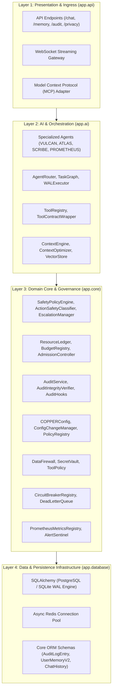

# C.O.P.P.E.R. Architecture Map & Subsystem Dependency Rules

## 1. Architectural Layer Hierarchy

In accordance with [ADR-0005](file:///d:/C.O.P.P.E.R/docs/adr/ADR-0005_LAYERED_ARCHITECTURE_BOUNDARIES.md), COPPER strictly enforces a 4-tier unidirectional dependency structure:

### Dependency Invariant Rule:
$$\text{Layer } N \longrightarrow \text{Layer } (N+1) \quad (\text{Downwards Only})$$
- `app.database` and `app.core` **must never import** from `app.ai` or `app.api`.
- Verified in CI via `scripts/lint_architecture.py`.

---

## 2. Subsystem Ownership Directory

| Subsystem Path | Primary Architectural Responsibility | Key Public Entrypoint |
| :--- | :--- | :--- |
| `backend/app/core/safety/` | Invariant enforcement, action risk classification, operator approval tickets | `action_safety_classifier`, `safety_escalation_manager` |
| `backend/app/core/finops/` | Hardware attribution, token budgets, admission control, storage sentinels | `resource_ledger`, `resource_admission_controller` |
| `backend/app/core/audit/` | Tamper-evident cryptographic SHA-256 hash chaining, verification | `audit_service`, `audit_verifier` |
| `backend/app/core/scalability/`| Deployment profiles (`desktop`, `homelab`, `cluster`), distributed locks | `profile_manager`, `distributed_lock_manager` |
| `backend/app/core/interop/` | Agent contracts, RFC 7807 error envelopes, MCP adapter, tool contracts | `mcp_adapter`, `tool_contract_wrapper` |
| `backend/app/core/configuration/`| Modular domain schemas (`COPPERConfig`), safe hot-reload, rollback | `master_config`, `config_change_manager` |
| `backend/app/ai/llm/` | Quantization-aware VRAM sizing, VRAM pager, pinned gatekeeper hot-swapping | `quantization_vram_estimator`, `vram_pager` |
| `backend/app/ai/memory/` | Hybrid RRF retrieval, context token budget optimization, deduplication | `context_optimizer`, `context_engine` |
