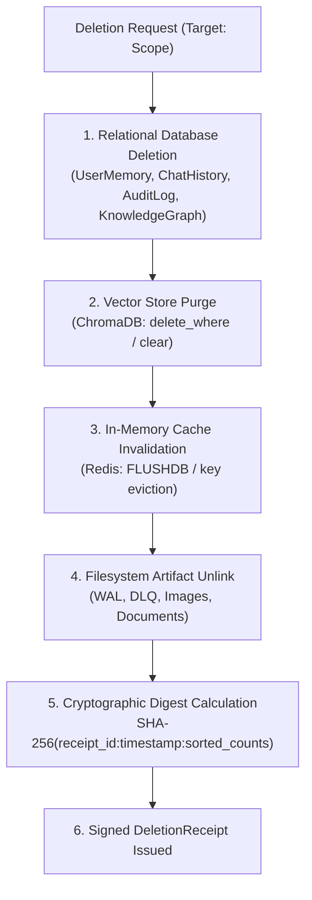

# COPPER Data Retention & Verifiable Deletion Policies

## 1. Overview & Statutory Alignment

This document outlines the retention lifecycle, user rights operational procedures, and cryptographic deletion verification protocols enforced by COPPER's `DataGovernanceManager`.

The framework implements technical controls aligned with major data protection regulations:
- **GDPR** (Articles 15 Right of Access, 16 Right to Rectification, 17 Right to Erasure, 20 Right to Data Portability)
- **CCPA / CPRA** (Consumer Right to Know, Delete, and Correct)
- **Local-First Zero-Trust Architecture** (All operations execute within the host system boundary)

---

## 2. Retention Schedules

Data stored across COPPER is subject to automatic retention enforcement routines executed via `POST /api/privacy/retention/enforce` or background schedulers.

| Asset Class | Classification | Retention Window | Purge Trigger | Cascade Actions |
| :--- | :--- | :--- | :--- | :--- |
| **User Memory Hypotheses** | `PERSONAL` | 90 Days | `confidence < 0.20 AND updated_at > 90d` | Relational purge + vector unindexing |
| **Confirmed User Memory** | `PERSONAL` / `SENSITIVE` | Indefinite (User-controlled) | User deletion request | Relational purge + vector unindexing |
| **Chat Conversation History** | `PERSONAL` | 180 Days | `created_at > 180d` | Relational table truncation |
| **System Audit Logs** | `INTERNAL` | 365 Days | `created_at > 365d` | Relational log purge |
| **Task Execution WAL** | `INTERNAL` | Execution duration | On task `COMPLETED` / `FAILED` | Immediate filesystem unlink |
| **Dead-Letter Queue (DLQ)** | `INTERNAL` | 30 Days | Manual resolution or age > 30d | Filesystem unlink |
| **Authentication & API Keys** | `RESTRICTED` | Ephemeral (Session) | Process termination / revocation | Memory zeroing & vault purge |

---

## 3. Cryptographic Verifiable Deletion Protocol

When a user or operator requests data erasure (either targeted or full system wipe), COPPER executes a synchronous multi-store cascade:



### Deletion Receipt Specification

Every deletion generates a verifiable `DeletionReceipt` containing:
- `receipt_id`: Unique UUIDv4 identifier.
- `timestamp`: ISO-8601 UTC timestamp.
- `target_scope`: Identified resource or `full_system_wipe`.
- `records_deleted`: Exact counts of affected records across all five stores.
- `verification_hash`: Cryptographic SHA-256 digest calculated as:
  $$\text{Hash} = \text{SHA-256}(\text{receipt\_id} \parallel ":" \parallel \text{timestamp} \parallel ":" \parallel \text{JSON}(\text{records\_deleted}))$$
- `verified`: Boolean confirmation flag.

Example Receipt JSON:
```json
{
  "receipt_id": "1846b45a-c60f-4886-905e-a61da2d515a4",
  "timestamp": "2026-11-10T12:00:00.000000+00:00",
  "target_scope": "memory_id:42",
  "records_deleted": {
    "relational_memories": 1,
    "chromadb_vectors": 1,
    "redis_keys": 0
  },
  "verification_hash": "e3b0c44298fc1c149afbf4c8996fb92427ae41e4649b934ca495991b7852b855",
  "verified": true
}
```

---

## 4. User Rights Operational Workflows

COPPER exposes dedicated API endpoints supporting all core data subject rights:

### 4.1 Right to Inspect & Export (Data Portability)
- **Endpoint**: `GET /api/privacy/export`
- **Output**: Complete machine-readable JSON package containing all user memories, conversation transcripts, episode history, and audit trails.
- **Integrity**: Includes a top-level `integrity_checksum` (SHA-256) calculated over all serialized payloads to guarantee tamper-resistance.

### 4.2 Right to Rectification (Correction)
- **Endpoint**: `POST /api/privacy/correct`
- **Payload**: `{"memory_id": 42, "new_content": "User prefers Dark Mode", "reason": "user_correction"}`
- **Execution**: Updates the relational record, resets confidence metrics, bumps evidence counters, deletes old embeddings in ChromaDB, and indexes the updated text.

### 4.3 Right to Erasure (Deletion)
- **Targeted Memory**: `DELETE /api/memory/{id}`
  - Cascades immediately across SQLite/PostgreSQL and ChromaDB.
- **Full Wipe**: `DELETE /api/privacy/delete-all`
  - Completely wipes relational memory tables, chat history, audit logs, vector collections, ephemeral cache, and file artifacts.

### 4.4 Consent Management
- **Endpoints**: `GET /api/privacy/consent` and `POST /api/privacy/consent`
- **Scopes**: Granular consent tracking for telemetry, external model routing, local memory extraction, and differential privacy noise parameters.
