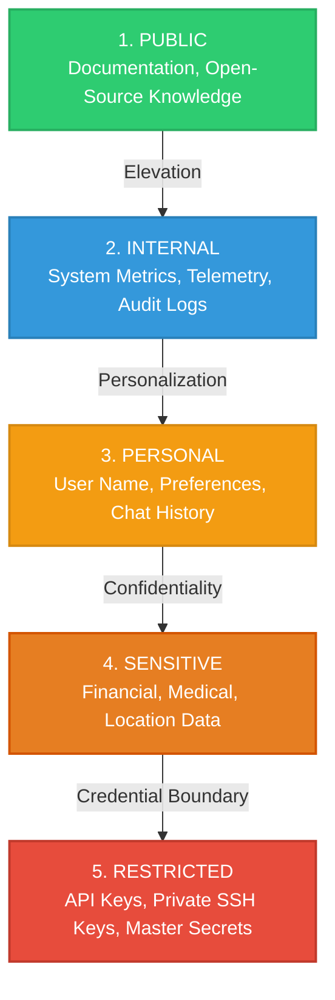
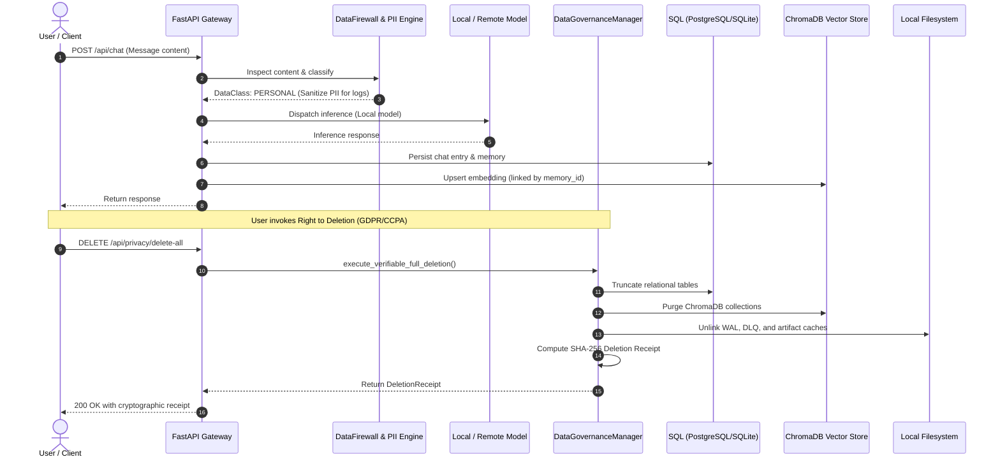

# COPPER Privacy & Data Governance Architecture

## 1. Executive Summary

COPPER's Privacy & Data Governance Architecture establishes strict, zero-trust data protection principles across all persistence layers, in-memory caches, vector collections, background task files, and model communication paths. 

Adhering to COPPER's **local-first operating philosophy**, all personal and sensitive user data is processed within the host environment. No sensitive or restricted user context is transmitted to cloud endpoints without explicit attribute authorization and cryptographic proof of consent.

---

## 2. Comprehensive Data Inventory

COPPER persists state across five distinct storage layers. The table below details the scope, classification, and persistence characteristics of each asset:

| Storage Layer | Data Asset / Table | Data Classification | Encryption at Rest | Encryption in Transit | Retention TTL | Deletion Mechanism |
| :--- | :--- | :--- | :--- | :--- | :--- | :--- |
| **Relational (PostgreSQL / SQLite)** | `user_memories_v2` | `PERSONAL` / `SENSITIVE` | AES-256 / LUKS | TLS 1.3 / Local UNIX | User-controlled / 90d (hypotheses) | Verifiable SQL deletion + receipt |
| **Relational (PostgreSQL / SQLite)** | `chat_history` | `PERSONAL` | AES-256 / LUKS | TLS 1.3 / Local UNIX | 180 Days | Purge via `enforce_retention_policies` |
| **Relational (PostgreSQL / SQLite)** | `audit_log_entries` | `INTERNAL` | AES-256 / LUKS | TLS 1.3 / Local UNIX | 365 Days | Retention purge |
| **Relational (PostgreSQL / SQLite)** | `episodes` | `INTERNAL` | AES-256 / LUKS | TLS 1.3 / Local UNIX | 90 Days | SQL delete cascade |
| **Relational (PostgreSQL / SQLite)** | `knowledge_entities` & `relationships` | `INTERNAL` | AES-256 / LUKS | TLS 1.3 / Local UNIX | Indefinite / Graph purge | Cascading foreign key delete |
| **Vector Store (ChromaDB)** | `copper_default`, `copper_memory` | `PERSONAL` / `SENSITIVE` | OS-level encryption | In-process / Local RPC | Synchronized with SQL | Synchronous ID unlinking & collection purge |
| **In-Memory Cache (Redis)** | Inference queues, token caches | `RESTRICTED` | Ephemeral RAM | Local socket | TTL <= 3600s | `FLUSHDB` / Key expiration |
| **Filesystem Storage** | `data/wal/` (Task WAL logs) | `INTERNAL` | OS-level encryption | N/A (Local disk) | Task completion | Post-execution unlink |
| **Filesystem Storage** | `data/dlq/` (Dead-letter queues) | `INTERNAL` | OS-level encryption | N/A (Local disk) | 30 Days | Manual replay or unlink |
| **Filesystem Storage** | `data/images/`, `data/documents/` | `PERSONAL` / `SENSITIVE` | OS-level encryption | N/A (Local disk) | User-controlled | Atomic filesystem unlink |

---

## 3. Unified 5-Tier Data Classification System

All data entering, passing through, or exiting COPPER is tagged with one of five standardized governance classifications:

### Policy Rules Matrix

| Classification | Egress Policy | Redact PII in Logs | Verifiable Deletion | Retention Default | Storage Requirement |
| :--- | :--- | :--- | :--- | :--- | :--- |
| **PUBLIC** | Allowed anywhere | No | No | Indefinite | Unrestricted |
| **INTERNAL** | Local-only or scrubbed | Yes | Yes | 365 Days | Dedicated schema |
| **PERSONAL** | Local or consented cloud | Yes | Yes | 180 Days | Isolated table / collection |
| **SENSITIVE** | Strictly local, no unconsented egress | Yes | Yes | 90 Days | Encrypted field-level storage |
| **RESTRICTED** | Strictly local, zero egress | Yes | Yes | Ephemeral (0 Days) | Hardware-backed / Memory vault only |

---

## 4. End-to-End Privacy Data Flow

---

## 5. Privacy Safeguards & PII Filtering

1. **Context-Aware PII Detection**: `DataFirewall` automatically matches and detects sensitive entity patterns:
   - Email addresses (`[REDACTED_EMAIL]`)
   - Phone numbers (`[REDACTED_PHONE]`)
   - Social Security Numbers / National IDs (`[REDACTED_SSN]`)
   - Credit card numbers (`[REDACTED_CREDIT_CARD]`)
   - API tokens and private keys (`[REDACTED_API_KEY]`, `[REDACTED_SECRET]`)
2. **Deterministic Pseudonymization & Differential Privacy**:
   - For statistical and telemetry export, the `DifferentialPrivacyEngine` injects calibrated Laplacian noise, preventing identification of user habits from aggregated query logs.
3. **No External Egress Without Consent**:
   - When configured in zero-trust mode, external LLM calls (e.g. OpenAI/Anthropic fallbacks) are blocked if the prompt contains `SENSITIVE` or `RESTRICTED` classifications.
