# C.O.P.P.E.R. Threat Model & Security Architecture

**Document Version:** 1.0.0 (Release Alpha)  
**Standard:** Grounded Threat Modeling (STRIDE / Zero Trust Local-First Architecture)  
**Scope:** `github.com/AkashKundu114/COPPER`  

---

## 1. System Overview & Assets

COPPER is an open-source, local-first personal AI desktop application combining a FastAPI backend, an Electron desktop shell with React 19 UI, local language-model inference via Ollama, an epistemic decaying memory engine with ChromaDB, and a 4-tier Guardian safety engine.

Because COPPER has the capability to run local code, interact with the filesystem, and process user context, security boundaries must be strictly defended against both traditional software vulnerabilities and AI-specific attack vectors.

### 1.1 Protected Assets

| Asset ID | Asset Name | Description & Impact of Compromise |
| :--- | :--- | :--- |
| **A-1** | **Host Filesystem & OS State** | Arbitrary file read, write, modification, or deletion on the user's host machine. |
| **A-2** | **Epistemic Memory & User Data** | Personal beliefs, preferences, calendar events, meeting transcripts, and conversation logs stored in `data/copper_memory.db` and ChromaDB vector store. |
| **A-3** | **API Credentials & Secrets** | Developer tokens, environment variables (`SECRET_KEY`, `POSTGRES_PASSWORD`, etc.), and user credentials stored on the machine. |
| **A-4** | **System Execution Integrity** | Uncontrolled or unverified command execution spawned by LLM agents. |
| **A-5** | **Offline Airgap Guarantee** | Preventing inadvertent exfiltration of telemetry, user prompts, or embeddings to third-party cloud servers. |

---

## 2. Threat Actors & Attack Vectors

```mermaid
flowchart TD
    Attacker[External / Indirect Threat Actors]
    BrowserAttacker["Malicious Website<br/>(Cross-Site / DNS Rebinding)"]
    DocAttacker["Untrusted Input File<br/>(Prompt Injection in PDF/HTML)"]
    ModelHallucination["Adversarial Model Output<br/>(Jailbreak / Hallucination)"]

    subgraph TrustBoundary1["Trust Boundary 1: Network & Browser"]
        BrowserAttacker -->|Origin Check Fail / 1008 Block| WSServer[Local WebSocket API]
        BrowserAttacker -->|Strict CORS Allowlist| RestAPI[FastAPI Localhost Endpoints]
    end

    subgraph TrustBoundary2["Trust Boundary 2: Ingestion & In-Memory Firewall"]
        DocAttacker -->|Data Firewall Regex Sanitization| IngestEngine[Document / Scrape Ingest]
        IngestEngine -->|AST Pre-flight Analysis| VectorStore[(ChromaDB Memory)]
    end

    subgraph TrustBoundary3["Trust Boundary 3: Model Output & Execution Guard"]
        ModelHallucination -->|Guardian 4-Tier Gatekeeper| GuardianEngine[Guardian Evaluator]
        GuardianEngine -->|Level 0: Safe| ExecutionEngine[Forge Sandbox Runner]
        GuardianEngine -->|Level 2/3: Block / Require Human Token| HumanApproval[User Challenge Modal]
    end
```

### 2.1 Threat Actors
1. **Malicious Web Pages (Cross-Site Localhost Attacks):** Malicious sites attempting DNS rebinding or unauthorized WebSocket/HTTP calls to `127.0.0.1:8000` to manipulate local state or exfiltrate memories.
2. **Indirect Prompt Injection:** Adversarial instructions embedded in scraped web content, indexed local documents, or emails designed to hijack agent instruction flow.
3. **Adversarial Jailbreaks & Evasion:** Users or inputs using homoglyphs, zero-width Unicode characters, Base64 encoding, or hypothetical roleplay to bypass command safety checks.
4. **Local Untrusted Code:** Generated code snippets attempting to escape the execution sandbox via reflection dunders (`__subclasses__`, `__globals__`), unauthorized imports (`subprocess`, `os`), or unbounded resource consumption (fork bombs).

---

## 3. Trust Boundaries & Security Enforcements

### 3.1 Network & Origin Isolation (Trust Boundary 1)
- **Localhost Binding:** In `docker-compose.yml` and dev scripts, services bind explicitly to `127.0.0.1` (never `0.0.0.0`).
- **Strict CORS Allowlist:** `CORSMiddleware` restricts HTTP origins to configured clients (`http://localhost:5173`, `http://localhost:3000`).
- **WebSocket Origin Validation:** `ConnectionManager` inspects `Origin` headers on incoming WebSocket connections. Connections from unapproved origins (e.g. `https://malicious-site.com`) are immediately terminated with WebSocket close code `1008` (Policy Violation).
- **Request Size Limits:** `RequestSizeLimitMiddleware` enforces a 2 MB ceiling on standard REST requests and 50 MB on multipart file uploads, preventing HTTP flood attacks and memory exhaustion.

### 3.2 Ingestion & Data Firewall (Trust Boundary 2)
- **PII & Secret Sanitization:** `DataFirewall` automatically redacts sensitive credentials (API tokens, private keys, credit cards, JWTs, password assignments) before indexing into ChromaDB or displaying in debug logs.
- **Epistemic Decay Floor:** Confidence ratings decay over time according to memory types (Fact half-life ~138 days, Observation ~23 days, Hypothesis ~7 days) preventing stale or poisoned observations from permanently influencing model context.

### 3.3 Execution Sandbox & AST Validation (Trust Boundary 3)
- **AST Static Security Analysis:** Prior to execution, Python code is parsed by `ast_security_validator` into an Abstract Syntax Tree. Any code containing:
  - Disallowed module imports (`os`, `subprocess`, `shutil`, `socket`, `ctypes`, `requests`, `urllib`)
  - Execution primitives (`eval`, `exec`, `compile`, `__import__`)
  - Introspection/metaclass dunders (`__subclasses__`, `__globals__`, `__builtins__`, `__code__`)
  is rejected before process creation.
- **Tiered Sandbox Runners:**
  1. `DockerSandboxRunner`: Docker container with `--cap-drop=ALL`, `--network=none`, `--read-only`, and restricted memory swap.
  2. `PyodideWasmRunner`: In-memory WebAssembly virtual machine with zero host filesystem access.
  3. `SubprocessSanitizedRunner`: Local fallback executing inside dedicated `sandbox/` working directory with stripped environment variables (removing credentials and system tokens) and hard execution timeouts.
- **Output Size Caps:** Sandbox standard output is capped at 100 KB to avoid denial-of-service via infinite stdout generation.

### 3.4 Guardian 4-Tier Gatekeeper (Human-in-the-Loop)
Guardian continuously scores action reversibility risk ($R$), operator fatigue ($F$), and goal conflict ($G$) to compute the continuous Dynamic Friction Index ($F_{idx} \in [0.0, 3.0]$):

- **Level 0 (EXECUTE):** Friction $< 1.0$, read-only safe requests. Auto-executed.
- **Level 1 (SUGGEST):** Friction $\in [1.0, 2.0)$, non-destructive suggestions or advisory warnings.
- **Level 2 (CHALLENGE):** Friction $\ge 2.0$ or detected commitment conflicts (e.g. altering schedules or bulk state modification). Server-side gate halts execution until explicit user confirmation is submitted.
- **Level 3 (SAFETY):** Destructive actions (`rm -rf`, format drives, drop database tables, chmod 777, reverse shells). Absolute server-side interception.

### 3.5 Adversarial Text Normalization
The Guardian pipeline applies `normalize_adversarial_text()` before pattern matching:
1. Strips zero-width and invisible bidirectional Unicode markers (`\u200b`, `\ufeff`, etc.).
2. Translates confusable Cyrillic and Greek homoglyphs to ASCII equivalents.
3. Automatically extracts and decodes embedded Base64 and hex payloads (`-EncodedCommand`, `fromhex(...)`) to inspect obfuscated commands.

---

## 4. Residual Risks & Operational Guidance

1. **Unsigned Desktop Installers:** Alpha release installers for Windows/macOS/Linux are self-signed or unsigned. Operating systems may surface SmartScreen or Gatekeeper advisories. Users should verify release SHA-256 checksums from the official GitHub Release.
2. **Third-Party Model Integrity:** Local GGUF/ONNX models should only be downloaded from trusted repositories (e.g. official Ollama library or verified HuggingFace authors).
3. **Data Erasure:** To completely wipe all local epistemic memory, conversation logs, and cached embeddings, execute `python scripts/wipe_data.py`.
