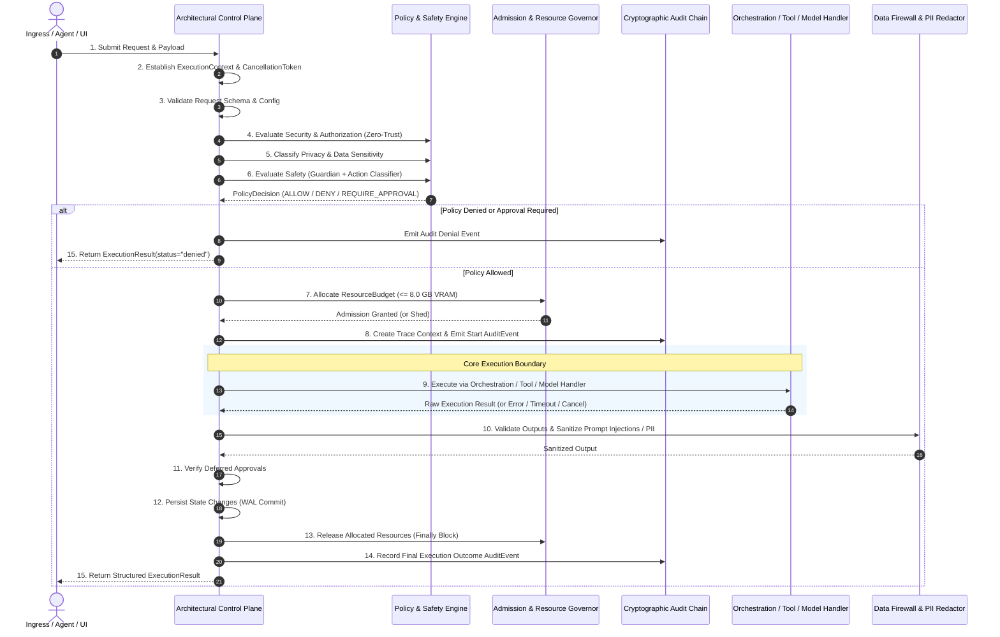

# Standardized 15-Step Execution Lifecycle

Every operation in COPPER—whether originating from an incoming HTTP request, desktop UI interaction, autonomous agent step, Chronos scheduled task, or background worker—is executed under the **Architectural Control Plane** (`backend/app/core/control_plane.py`) according to the standardized 15-step execution lifecycle.

---

## Lifecycle Flow Diagram



---

## Detailed Step-by-Step Specification

### Step 1: Receive Request
The ingress gateway accepts raw input parameters (action, target, arguments, actor, execution origin).

### Step 2: Establish Execution Identity & Context
Constructs a unified, strongly-typed `ExecutionContext`:
- Unique `request_id`, `trace_id`, and `task_id`.
- Correlation IDs linking parent and child tasks.
- Dedicated `CancellationToken` for cooperative interruption.
- Data sensitivity classification (default `INTERNAL`).

### Step 3: Validate Request & Configuration
Validates input schemas, argument bounds, and confirms that execution deadline has not expired prior to initialization.

### Step 4: Evaluate Security & Authorization
Zero-Trust security checks:
- Verify local-first invariant: attempts to request external network egress (`network_egress_allowed=True`) are immediately denied with `SEC-001-LOCAL-FIRST`.
- Dynamic Trust Fabric evaluation: inspects subagent behavioral scores; revokes access if trust score $< 0.30$.

### Step 5: Classify Privacy & Data Sensitivity
Assigns canonical sensitivity level: `PUBLIC`, `INTERNAL`, `CONFIDENTIAL`, or `RESTRICTED`. Sets data masking and encryption invariants.

### Step 6: Evaluate Safety Requirements
Dual-layer safety evaluation:
- **Guardian Safety Engine:** Rejects hard safety invariants (e.g., destructive disk wipes, fork bombs, PTY breakouts).
- **4-Tier Action Classifier:** Categorizes action into `READ_ONLY` (Level 0), `REVERSIBLE` (Level 1), `CONSEQUENTIAL` (Level 2, requires operator ticket), or `IRREVERSIBLE` (Level 3, blocked).

### Step 7: Allocate Resource Budget
Evaluates proposed workload against host capacity via `ResourceAdmissionController`:
- Enforces strict hardware invariant: requested VRAM must not exceed the physical 8.0 GB ceiling.
- Under high VRAM pressure ($\ge 85\%$), sheds background tasks gracefully to prevent UI freeze.

### Step 8: Create Trace & Audit Context
Appends an `IN_PROGRESS` audit event to the cryptographic HMAC-SHA256 hash-chained ledger, binding actor, target, trace ID, and timestamp.

### Step 9: Execute through Appropriate Orchestration Path
Invokes target handler with `ExecutionContext`:
- Monitored by cooperative `CancellationToken`.
- Bound by configured execution timeout (`asyncio.wait_for`).
- Exceptions caught and routed to `DeadLetterQueue` for resilience.

### Step 10: Validate Outputs & Sanitize Results
Sanitizes raw output:
- Escapes untrusted tool tags (`<tool_call>`, `<system>`) via `sanitize_untrusted_text`.
- Neutralizes indirect prompt injection attempts (`[REDACTED_PROMPT_INJECTION]`).
- Redacts credentials, private keys, emails, and filesystem paths via `DataFirewall` if marked `CONFIDENTIAL` or `RESTRICTED`.

### Step 11: Apply Approval Requirements Where Necessary
If execution requires human-in-the-loop validation, execution halts until an authorized operator confirmation signature is received.

### Step 12: Persist Permitted State Changes
State changes are safely committed through the Write-Ahead Log (`TaskWAL`). Incomplete or interrupted tasks trigger automatic rollback.

### Step 13: Release Resources (Guaranteed in Finally Block)
De-registers task from `_active_tasks`, reclaims allocated VRAM and memory buffers, and updates FinOps resource ledgers.

### Step 14: Record Final Execution Outcome
Seals a completion (`SUCCESS`, `CANCELLED`, or `FAILED`) `AuditEvent` into the tamper-evident hash chain with duration metrics and error details.

### Step 15: Return Structured Response
Returns standardized `ExecutionResult`:
```python
@dataclass
class ExecutionResult:
    status: str  # "success", "error", "denied", "cancelled"
    data: Any
    context: dict[str, Any]
    policy_decision: dict[str, Any]
    execution_time_ms: float
    trace_id: str
    task_id: str
    error: str | None
    audit_event_id: str | None
```
