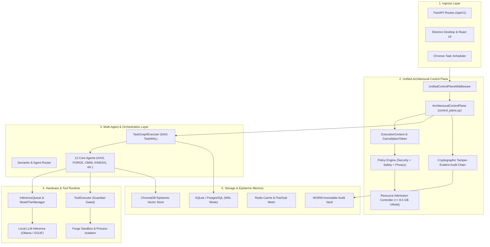

# COPPER — Unified Architectural Control Plane & Sovereign System Integration

## 1. Executive Summary & Vision

**C.O.P.P.E.R.** (Centralized Omnifunctional Personal Productivity and Execution Routine) is an autonomous, local-first, privacy-conscious personal AI operating system. It orchestrates multi-agent task execution, dynamic model inference, persistent hierarchical memory, sandboxed tool execution, and desktop integration.

While previous engineering stages developed foundational capabilities across 12 distinct domains, this unified architecture establishes a single **Architectural Control Plane** (`backend/app/core/control_plane.py`) that governs every task, model invocation, agent action, and storage mutation under shared invariants:
1. **Local-First Zero External Egress:** All model inference, zero-knowledge proofs, vector searches, and data mutations occur strictly on local workstation hardware.
2. **Strict Hardware Ceiling ($\le 8.0\text{ GB}$ Physical VRAM):** Dynamic model offloading, memory compaction, and hardware-aware quantization (`Q4_K_M`) ensure stable operation without thrashing.
3. **One Execution Context:** Every operation inherits a unified, strongly-typed `ExecutionContext` carrying tracing, policy, privacy classification, and resource budgets.
4. **Tamper-Evident Accountability:** Every security-sensitive state change and tool execution is sealed into a cryptographic HMAC-SHA256 hash-linked audit chain.

---

## 2. High-Level System Architecture Diagram



---

## 3. The 12 Architectural Foundations & Authoritative Subsystems

| # | Foundation Domain | Authoritative Implementation | Shared Contract / Policy |
|---|---|---|---|
| **1** | **Zero-Trust Security** | `app.core.security.dynamic_trust_fabric_evaluator`, `tool_policy.py`, `agent_token.py` | `DynamicTrustFabricEvaluator`, `PolicyDecision`, `SEC-001` Local-first |
| **2** | **Unified Observability** | `app.core.telemetry`, `app.core.observability.distributed_trace_correlator`, `metrics.py` | `X-Trace-Id`, OpenTelemetry spans, Prometheus exposition |
| **3** | **Reliability & Resilience** | `app.core.resilience.circuit_breaker`, `dead_letter_queue.py`, `wal_executor.py` | `CircuitBreaker`, `TaskWAL` rollback, bounded backoff |
| **4** | **Privacy & Data Governance** | `app.core.privacy.classification`, `data_firewall.py`, `retention_sweeper.py` | `DataSensitivity`, `DataFirewall` PII masking, cross-store purge |
| **5** | **AI Safety & Alignment** | `app.core.guardian`, `app.core.safety.action_classifier`, `prompt_injection.py` | 4-tier risk classification, Guardian hard invariants, injection filter |
| **6** | **Performance & Optimization** | `app.ai.auto_quantization_selector`, `dynamic_vram_compactor.py`, `model_tier_manager.py` | $\le 8.0\text{ GB}$ physical VRAM ceiling, KV-cache defragmentation |
| **7** | **Scalability** | `app.core.scalability.adaptive_load_shedder`, `multi_tenant_quota_governor.py` | Token bucket quota, Little's Law backpressure |
| **8** | **Interoperability** | `app.core.interop.tool_contract`, `mcp_adapter.py`, `universal_plugin_bridge.py` | Standardized `ToolCall` and `ToolResult` schemas |
| **9** | **Configuration & Policy** | `app.core.config.settings`, `immutable_signed_policy_pack.py`, `policy_registry.py` | Deterministic policy precedence hierarchy |
| **10** | **Auditability & Accountability** | `app.core.control_plane.ArchitecturalControlPlane`, `quantum_safe_audit_chain.py` | Cryptographic HMAC-SHA256 hash-chained `AuditEvent` |
| **11** | **Maintainability & Evolvability** | `scripts/lint_architecture.py`, `architectural_fitness.py` | Layer boundary enforcement (0 AST boundary violations) |
| **12** | **Cost & Resource Governance** | `app.core.finops.admission_controller`, `resource_governor.py`, `ledger.py` | Explicit `ResourceBudget` allocation and release |

---

## 4. Layer Boundary Governance

Following Architectural Decision Record `ADR-0005`, system packages enforce strict unidirectional dependency flow:

```
[ app.api / app.ui ]   (High-level controllers & routing)
         |
         v
[ app.ai / app.services ] (Orchestration, agents, models, tools)
         |
         v
[ app.core / app.database ] (Foundational control plane, storage, resilience)
```

Low-level foundational modules (`app.core`, `app.database`) are strictly prohibited from importing higher-level application modules (`app.ai`, `app.api`), verified by automated static AST linting (`python scripts/lint_architecture.py`).
