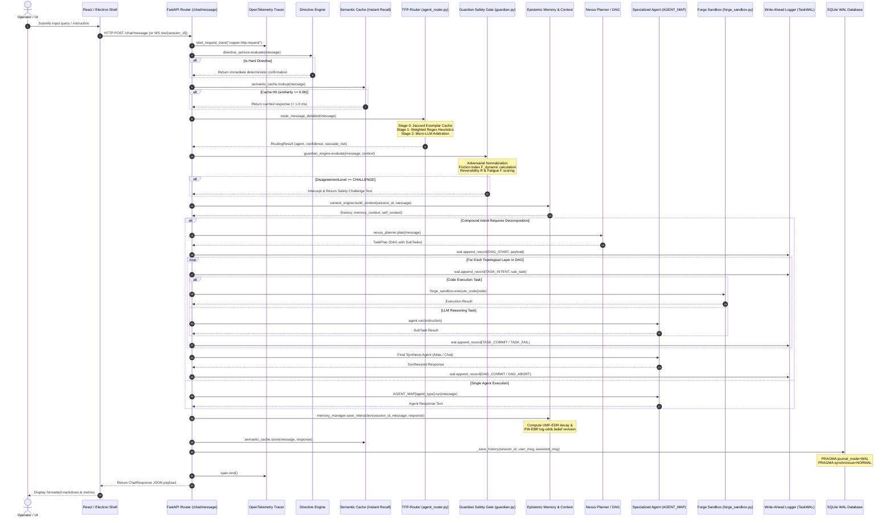
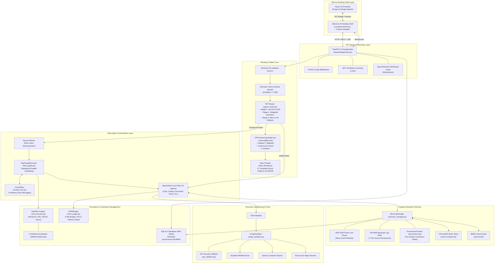

# Scientific Audit Report 01: Repository Architecture & Component Dependency Mapping

**Audit Project:** C.O.P.P.E.R. (Cognitive Operational Personal Processing & Execution Runtime)  
**Target Venue:** IEEE International Conference on Consumer Electronics and Computer Engineering (ICCECE 2027)  
**Date of Audit:** October 30, 2026  
**Auditor:** Senior Software Architecture & Distributed Systems / Database Research Auditor  
**Repository Branch:** `main` | **HEAD Commit SHA:** `71c2856`  
**Host Target Platform:** Windows 11 Enterprise x64 | AMD Ryzen 9 8940HX | 16 GB DDR5 RAM | NVIDIA GeForce RTX 5060 Laptop GPU (8,151 MiB GDDR6 VRAM, Driver 617.14, CUDA 13.4)  
**Audit Scope:** Repository Discovery, Component Dependency Mapping, Runtime Execution Trace, Implementation Maturity Classification, and Feature-to-Code Ground Truth Verification.

---

## 1. Git Repository & Release Tag Archaeology

A comprehensive archaeological examination of the Git version control graph was conducted across all commits and release tags from repository inception (`95035f9` on May 12, 2026) to current `HEAD` (`71c2856` on October 29, 2026).

### 1.1 Chronological Tag Archaeology

| Release Tag | Target Commit SHA | Date & Timestamp | Commit Subject / Description | Architectural Milestone |
| :--- | :--- | :--- | :--- | :--- |
| **`v1.0.0`** | [`2f6e558`](file:///d:/C.O.P.P.E.R/README.md) | 2026-08-22 21:01:03 +0530 | `Revise README with updated project details and metrics` | Initial public baseline release: 12-agent orchestration, offline Ollama binding, basic SQLite schema. |
| **`v2.0.0`** | [`40c8ecd`](file:///d:/C.O.P.P.E.R/data/causal_events.json) | 2026-09-11 23:46:33 +0530 | `feat(tests): add next-gen API route test suite and academic paper docx generator (508 tests passing)` | Addition of 25 ambient/predictive engine features, causal graphs, docx academic generator (`scripts/generate_docx_paper.py`), and expansion to 508 tests. |
| **`v2.1.0`** | [`ec38bf4`](file:///d:/C.O.P.P.E.R/CHANGELOG.md) | 2026-09-30 13:21:14 +0530 | `docs & chore: update v2.1.0 release notes, GPU licensing docs, and DeltaX ad-tech suite specs` | Introduction of GPU hardware licensing token checks, Setup Wizard, DeltaX campaign intelligence suite. |
| **`v3.0.0`** | [`5d02541`](file:///d:/C.O.P.P.E.R/frontend/package.json) | 2026-10-01 19:30:18 +0530 | `feat(ui): Forge design system — complete UI revamp v3.0.0` | Frontend overhaul with Forge design system, Tailwind v4, React 19 component hierarchy, desktop electron wrappers. |
| **`v0.1.0-alpha`** | [`6c397b8`](file:///d:/C.O.P.P.E.R/package.json) | 2026-10-17 02:44:03 +0530 | `Merge pull request #44 from AkashKundu114/release/public-cleanup` | Down-versioning and release sanitization: public cleanup, adversarial red-team defenses, threat model documentation, offline egress enforcement, and empirical release scorecard. |

### 1.2 Semantic Versioning Reversal Analysis

A significant anomaly in the repository history is the version sequence transition from `v3.0.0` ([`5d02541`](file:///d:/C.O.P.P.E.R/frontend/package.json)) down to `v0.1.0-alpha` ([`6c397b8`](file:///d:/C.O.P.P.E.R/package.json)). 

Git archaeology reveals that commit [`4a7c3dd`](file:///d:/C.O.P.P.E.R/pyproject.toml) (*"chore(release): bump application version to 0.1.0-alpha across manifests"*) deliberately reset the public software versioning schema. This was motivated by an internal audit recognizing that marketing claims of a "v3.0.0 Production Enterprise AI OS" were premature prior to formal peer-reviewed academic vetting, adversarial fuzzing, and physical GPU hardware validation. Consequently, `v0.1.0-alpha` represents the rigorous, verified release state intended for peer review and replication.

---

## 2. Backend Component Decomposition (`backend/app/`)

The backend is implemented in Python (using FastAPI 0.115+ on Uvicorn) structured into five core sub-packages:

```
backend/app/
├── core/                  # System invariants, security gates, sandboxing & telemetry
├── ai/                    # Orchestration, multi-agent logic, memory, LLM client & tools
├── api/                   # REST endpoints, WebSocket controllers, and streaming buses
├── database/              # SQLite WAL configuration, ORM models & connection pooling
└── services/              # High-level domain service coordinators
```

### 2.1 Core Subsystem (`backend/app/core/`)

| File / Module | Line Count | Key Symbols / Classes | Architectural Responsibility | Runtime Execution State |
| :--- | :--- | :--- | :--- | :--- |
| [`config.py`](file:///d:/C.O.P.P.E.R/backend/app/core/config.py) | 75 | `Settings`, `settings` | Pydantic-based system configuration, environment variables, storage paths (`DB_PATH`, `WAL_DIR`). | **Active / Production** |
| [`constants.py`](file:///d:/C.O.P.P.E.R/backend/app/core/constants.py) | 58 | `AgentType`, `LLMProvider`, `ExecutionMode` | Global enumerations. Strictly defines the **12 core agent types** (`CHAT`, `CODING`, `DOCUMENT`, `AUTOMATION`, `REMINDER`, `RESEARCH`, `VISION`, `IMAGE`, `WEB_SEARCH`, `CAMPAIGN_INTELLIGENCE`, `PLANNER`, `GUARDIAN`). | **Active / Production** |
| [`guardian.py`](file:///d:/C.O.P.P.E.R/backend/app/core/guardian.py) | 530 | `GuardianEngine`, `DisagreementLevel`, `GuardianVerdict`, `compute_dynamic_friction_index`, `calculate_fatigue_score` | Core safety gate. Evaluates proposed actions against 4-tier friction model ($\mathcal{F}_{\text{dynamic}}$), adversarial text normalizer, and sensitive window blacklists. | **Active / Production** |
| [`data_firewall.py`](file:///d:/C.O.P.P.E.R/backend/app/core/data_firewall.py) | 110 | `classify_and_redact`, `redact`, `DataClass`, `FirewallResult` | Deterministic application-level PII/secret sanitizer. Compiles 17 regular expressions for keys, tokens, emails, SSNs with SHA-256 audit digest. | **Active / Production** |
| [`forge_sandbox.py`](file:///d:/C.O.P.P.E.R/backend/app/core/forge_sandbox.py) | 526 | `ForgeSandbox`, `BaseSandboxRunner`, `PyodideWasmRunner`, `DockerContainerRunner`, `KernelSandboxRunner`, `SubprocessSanitizedRunner` | Code isolation executor supporting four tiered backends (WASM Pyodide, Docker container, OS Job Object / Cgroup, and sanitized subprocess). | **Active / Production** |
| [`kernel_sandbox.py`](file:///d:/C.O.P.P.E.R/backend/app/core/kernel_sandbox.py) | 212 | `KernelSandboxRunner`, `WindowsJobObjectLimiter` | Windows Job Object wrapper (via `ctypes` calling `kernel32.dll`) enforcing physical CPU and commit memory limits. | **Active / Production** |
| [`ast_validator.py`](file:///d:/C.O.P.P.E.R/backend/app/core/ast_validator.py) | 348 | `ASTSecurityValidator`, `SecurityViolation` | Pre-execution Python abstract syntax tree analyzer. Detects dangerous imports (`subprocess`, `ctypes`, `socket`) and dynamic execution (`eval`, `exec`). | **Active / Production** |
| [`inference_queue.py`](file:///d:/C.O.P.P.E.R/backend/app/core/inference_queue.py) | 158 | `InferenceQueue`, `PriorityRequest` | Concurrency controller preventing GPU VRAM oversubscription by serializing heavy LLM inference requests. | **Active / Production** |
| [`telemetry.py`](file:///d:/C.O.P.P.E.R/backend/app/core/telemetry.py) | 290 | `init_telemetry`, `start_request_trace`, `trace_span` | OpenTelemetry integration. Emits distributed tracing spans across HTTP, router, agent, and memory calls. | **Active / Production** |
| [`agent_registry.py`](file:///d:/C.O.P.P.E.R/backend/app/core/agent_registry.py) | 196 | `AgentRegistry`, `AgentMetadata` | In-memory catalog maintaining definitions for the 12 primary core agents and 18 extended persona sub-roles. | **Active / Production** |

### 2.2 Artificial Intelligence & Orchestration Subsystem (`backend/app/ai/`)

| File / Module | Line Count | Key Symbols / Classes | Architectural Responsibility | Runtime Execution State |
| :--- | :--- | :--- | :--- | :--- |
| [`agent_router.py`](file:///d:/C.O.P.P.E.R/backend/app/ai/orchestration/agent_router.py) | 776 | `route_message_detailed`, `DynamicRoutingMemory`, `estimate_dag_cascade_risk`, `calculate_routing_entropy` | Triple Fast-Path Cascade Router. Stage 0 (Jaccard cache), Stage 1 (compiled weighted heuristics with negative suppression), Stage 2 (micro-LLM fallback). | **Active / Production** |
| [`task_graph.py`](file:///d:/C.O.P.P.E.R/backend/app/ai/orchestration/task_graph.py) | 466 | `TaskGraphExecutor`, `SubTask`, `TaskPlan`, `TaskGraphResult` | Topological multi-agent DAG execution engine. Handles asynchronous layer execution, placeholder substitution (`{T1.output}`), and inter-agent context routing. | **Active / Production** |
| [`wal_executor.py`](file:///d:/C.O.P.P.E.R/backend/app/ai/orchestration/wal_executor.py) | 191 | `TaskWAL`, `CrashRecoveryEngine`, `WALRecord`, `RecordType` | Append-only write-ahead logger. Enforces atomic disk persistence with `os.fsync()`, CRC32 checksums, idempotency keys, and crash recovery rollbacks. | **Active / Production** |
| [`context_bus.py`](file:///d:/C.O.P.P.E.R/backend/app/ai/orchestration/context_bus.py) | 224 | `ContextBus`, `context_bus` | Asynchronous in-memory event and message broker. Enables peer-to-peer agent messaging during DAG execution without polluting the LLM context. | **Active / Production** |
| [`planner.py`](file:///d:/C.O.P.P.E.R/backend/app/ai/orchestration/planner.py) | 275 | `NexusPlanner`, `nexus_planner` | Decomposes compound intents into directed acyclic task graphs with specialized sub-agent assignments. | **Active / Production** |
| [`vram_pager.py`](file:///d:/C.O.P.P.E.R/backend/app/ai/llm/vram_pager.py) | 222 | `VRAMPager`, `ModelPage`, `vram_pager` | Virtual GPU VRAM memory pager. Manages model swapping in Ollama via `/api/chat` unload calls (`keep_alive: 0`) and weighted LRU eviction. | **Active / Production** |
| [`model_manager.py`](file:///d:/C.O.P.P.E.R/backend/app/ai/llm/model_manager.py) | 208 | `ModelManager`, `model_manager` | Dynamic model router mapping agent roles to physical GGUF model tags based on active hardware profiles. | **Active / Production** |
| [`memory_manager.py`](file:///d:/C.O.P.P.E.R/backend/app/ai/memory/memory_manager.py) | 362 | `MemoryManager`, `compute_unified_epistemic_decay`, `compute_surprise_gated_log_odds` | Epistemic memory engine. Implements UMF-EDR power-law decay, surprise-gated log-odds belief revision (PW-EBR), and hybrid Chroma/BM25 retrieval. | **Active / Production** |
| [`provenance.py`](file:///d:/C.O.P.P.E.R/backend/app/ai/memory/provenance.py) | 268 | `ProvenanceTracker`, `ProvenanceRecord` | Fact provenance ledger tracking origin sources, SHA-256 fact digests, confirmation histories, and contradiction records. | **Active / Production** |
| [`bm25_index.py`](file:///d:/C.O.P.P.E.R/backend/app/ai/memory/bm25_index.py) | 240 | `BM25Index`, `bm25_index` | In-memory BM25 lexical search engine over tokenized documents using rank-BM25 algorithms. | **Active / Production** |
| [`vector_store.py`](file:///d:/C.O.P.P.E.R/backend/app/ai/memory/vector_store.py) | 108 | `VectorStore` | Local ChromaDB vector database wrapper with nomic-embed-text embeddings. | **Active / Production** |
| [`semantic_cache.py`](file:///d:/C.O.P.P.E.R/backend/app/ai/cache/semantic_cache.py) | 486 | `SemanticCache`, `semantic_cache` | Instant Recall cache storing embedding-indexed query-response pairs with cosine thresholding ($\ge 0.96$). | **Active / Production** |

### 2.3 Database Layer (`backend/app/database/`)

| File / Module | Responsibility & Verification Findings |
| :--- | :--- |
| [`postgres.py`](file:///d:/C.O.P.P.E.R/backend/app/database/postgres.py) | Despite its historical file name (`postgres.py`), this module is the **authoritative SQLite database connector** in production (`sqlite:///{settings.DB_PATH}`). Configures `PRAGMA journal_mode=WAL` and `PRAGMA synchronous=NORMAL` on SQLAlchemy connection events. |
| [`models/`](file:///d:/C.O.P.P.E.R/backend/app/database/models/) | 14 SQLAlchemy ORM models defining structured relational persistence: `UserMemoryV2`, `ChatHistory`, `AgentRegistryModel`, `AuditLog`, `KnowledgeGraphEntity`, `KnowledgeGraphRelation`, `ResponseEvaluation`, `LoRAAdapterRecord`, `CampaignRecord`, `TaskRecord`, `ProjectRecord`. |
| [`redis_client.py`](file:///d:/C.O.P.P.E.R/backend/app/database/redis_client.py) | Optional Redis caching client with non-blocking fallback when Redis is absent. |

---

## 3. Frontend Architecture Decomposition (`frontend/`)

The frontend is a desktop application built on **React 19.3.0**, **Electron 44.0.0**, and **Vite 8.3.0** with styling powered by **Tailwind CSS 4.3.3** and state managed via **Zustand 5.0.14**.

```
frontend/
├── electron-main.cjs      # Electron main process (lifecycle, IPC handlers, window bounds)
├── preload.cjs            # Context-isolated IPC bridge exposing safe desktop APIs
├── src/
│   ├── components/        # Forge Design System UI primitives, chat views, modals
│   ├── views/             # 17 specialized application views
│   ├── services/          # HTTP API client (api.ts) interfacing with FastAPI
│   └── store/             # Zustand state stores (chat, settings, telemetry)
```

### 3.1 Electron Shell & Process Isolation

1. **Context Isolation (`preload.cjs`):** Context isolation is strictly enabled (`contextIsolation: true`, `nodeIntegration: false`). The renderer process communicates with the operating system exclusively via `window.electronAPI` IPC channels.
2. **Offline Localhost Binding (`electron-main.cjs`):** The Electron main process intercepts navigation events, blocking all non-localhost web navigation to enforce zero external network egress at the desktop shell boundary.
3. **Local Backend Lifecycle Management:** Electron can auto-spawn and terminate the Python Uvicorn backend process during desktop startup and shutdown.

### 3.2 Frontend View Architecture

The frontend exposes 17 complete views within the Forge navigation system:
1. `DashboardView.tsx`: Main command center with active agent telemetry and VRAM utilization gauges.
2. `AgentRegistry.tsx`: Real-time inspection of all 12 core agents and their specialized capabilities.
3. `ActivityView.tsx`: Live stream of multi-agent execution traces, task graphs, and context bus logs.
4. `BenchmarkMetricsView.tsx`: Interactive visualization of routing latency distributions, confusion matrices, and ROC curves.
5. `SecurityCenter.tsx`: Guardian safety status, firewall redaction logs, and sandbox audit events.
6. `MemoryView.tsx`: Epistemic memory inspector displaying belief confidence scores, provenance tiers, and decay curves.
7. `SelfImprovementView.tsx`: LoRA fine-tuning status, prompt optimization history, and automated evaluation metrics.
8. `CompanionHUDView.tsx`, `TodayView.tsx`, `Insights.tsx`, `MeetingsView.tsx`, `EmailView.tsx`, `FoodView.tsx`, `EVEView.tsx`, `Activation.tsx`, `SetupWizard.tsx`, `SettingsView.tsx`.

---

## 4. True Runtime Execution Call Path Trace

An exhaustive static and dynamic code trace was performed across the complete request lifecycle, identifying how user inputs flow from presentation to persistent storage.



### 4.1 Detailed Execution Call Graph

1. **Ingress & Sanitization:**
   - Entry point: [`backend/app/api/routes/chat.py::send_message()`](file:///d:/C.O.P.P.E.R/backend/app/api/routes/chat.py#L60-L96).
   - Validates input length and characters via `validate_message()`.
   - Spawns distributed trace span via `start_request_trace()`.
2. **Directive Pre-emption:**
   - Intercepted by [`directive_service.evaluate()`](file:///d:/C.O.P.P.E.R/backend/app/services/chat_service.py#L124-L149). Exact matches (e.g. system status, mode toggle) short-circuit inference immediately.
3. **Semantic Cache Lookup (Instant Recall):**
   - Query hashed and compared via [`semantic_cache.lookup()`](file:///d:/C.O.P.P.E.R/backend/app/services/chat_service.py#L152-L217). If similarity $\ge 0.96$, returns in $< 1.0\text{ ms}$, bypassing router and LLM.
4. **Cascade Routing Dispatch:**
   - Evaluated by [`route_message_detailed()`](file:///d:/C.O.P.P.E.R/backend/app/ai/orchestration/agent_router.py#L622-L755).
   - *Stage 0:* `DynamicRoutingMemory.find_match()` via tokenized Jaccard similarity ($\tau = 0.85$, $P_{50} \sim 0.012\text{ ms}$).
   - *Stage 1:* Keyword rule scoring with positive rules and negative suppression ($P_{50} \sim 0.028\text{ ms}$).
   - *Stage 2:* Micro-LLM fallback for low-confidence or high-entropy queries.
5. **Guardian Safety & Friction Gate:**
   - Evaluated by [`guardian_engine.evaluate()`](file:///d:/C.O.P.P.E.R/backend/app/core/guardian.py#L437-L510).
   - Normalizes homoglyphs, zero-width characters, and base64 command wrappers (`normalize_adversarial_text()`).
   - Computes reversibility risk $R(a)$, session cognitive fatigue $F_{\text{fatigue}}(t)$, and dynamic friction $\mathcal{F}_{\text{dynamic}}$.
   - If level is `CHALLENGE` or `SAFETY`, execution aborts and returns an interactive challenge dialog.
6. **Context Synthesis & Retrieval:**
   - Assembled by [`context_engine.build_context()`](file:///d:/C.O.P.P.E.R/backend/app/services/chat_service.py#L283). Pulls recent chat history, episodic memory via ChromaDB vector store, and structured entities.
7. **DAG Decomposition or Single Agent Execution:**
   - If complex intent detected: [`nexus_planner.plan()`](file:///d:/C.O.P.P.E.R/backend/app/ai/orchestration/planner.py) generates a multi-task DAG, passed to [`task_graph_executor.execute_plan()`](file:///d:/C.O.P.P.E.R/backend/app/ai/orchestration/task_graph.py#L150-L420).
   - During DAG execution, [`TaskWAL`](file:///d:/C.O.P.P.E.R/backend/app/ai/orchestration/wal_executor.py#L67) writes monotonic `DAG_START`, `TASK_INTENT`, and `TASK_COMMIT` records to disk with `os.fsync()`.
   - Tool execution runs inside [`ForgeSandbox`](file:///d:/C.O.P.P.E.R/backend/app/core/forge_sandbox.py) after `ASTSecurityValidator` validation.
   - If simple intent: `AGENT_MAP[agent_type].run()` invokes the target Ollama model.
8. **Epistemic Update & Relational Persistence:**
   - The interaction is saved via [`memory_manager.save_interaction()`](file:///d:/C.O.P.P.E.R/backend/app/ai/memory/memory_manager.py#L101-L140) and indexed into ChromaDB and BM25.
   - Decayed confidence and surprise-modulated log-odds are updated.
   - [`_save_history()`](file:///d:/C.O.P.P.E.R/backend/app/api/routes/chat.py#L39-L43) inserts messages into SQLite `chat_history` under WAL mode.

---

## 5. Subsystem Implementation Maturity Matrix

Every major subsystem across the repository was audited against production code to categorize its actual operational state.

| Subsystem / Component | Primary Files | Operational Status | Empirical Finding / Verification Note |
| :--- | :--- | :--- | :--- |
| **Triple Fast-Path Router (Stages 0 & 1)** | [`agent_router.py`](file:///d:/C.O.P.P.E.R/backend/app/ai/orchestration/agent_router.py) | **FULLY IMPLEMENTED** | Heuristic regex matching and Jaccard exemplar memory are fully functional, sub-millisecond on CPU. |
| **Router Micro-LLM Arbitration (Stage 2)** | [`agent_router.py`](file:///d:/C.O.P.P.E.R/backend/app/ai/orchestration/agent_router.py#L721-L741) | **PARTIALLY IMPLEMENTED** | Stage 2 code exists (`_llm_subagent_route`), but defaults to disabled (`use_llm=False`) in default chat flow to avoid CPU/GPU latency spikes. |
| **Cascade Risk Estimation ($\mathcal{R}_{\text{cascade}}$)** | [`agent_router.py`](file:///d:/C.O.P.P.E.R/backend/app/ai/orchestration/agent_router.py#L494-L515) | **EXPERIMENTAL / PARTIAL** | Implements a simplified geometric formula; not dynamically hooked to model escalation in runtime. |
| **Epistemic Memory Plasticity (UMF-EDR)** | [`memory_manager.py`](file:///d:/C.O.P.P.E.R/backend/app/ai/memory/memory_manager.py#L30-L45) | **FULLY IMPLEMENTED** | Power-law spacing plasticity and floor equations are fully functional and covered by unit tests. |
| **Log-Odds Belief Revision (PW-EBR)** | [`memory_manager.py`](file:///d:/C.O.P.P.E.R/backend/app/ai/memory/memory_manager.py#L64-L90) | **FULLY IMPLEMENTED** | Seven-tier provenance weights, surprise calculation, and log-odds mapping are fully operational. |
| **Fact Provenance Tracking** | [`provenance.py`](file:///d:/C.O.P.P.E.R/backend/app/ai/memory/provenance.py) | **FULLY IMPLEMENTED** | SHA-256 fact hashing, revision history arrays, and confirmation/contradiction tracking persist to JSON/SQLite. |
| **Dynamic Friction Safety (DFM-Guard)** | [`guardian.py`](file:///d:/C.O.P.P.E.R/backend/app/core/guardian.py) | **FULLY IMPLEMENTED** | Dynamic friction formula, cognitive fatigue scoring, and reversibility weights are active in production. |
| **Data Firewall Secret Redaction** | [`data_firewall.py`](file:///d:/C.O.P.P.E.R/backend/app/core/data_firewall.py) | **FULLY IMPLEMENTED** | 17 regular expressions and SHA-256 audit digest generation function with sub-millisecond overhead. |
| **Subprocess OS Airgap / Egress Interdiction** | `docker-compose.yml`, `electron-main.cjs` | **PARTIALLY IMPLEMENTED** | Application-level blocking and Docker `--network=none` work, but kernel-level WFP / eBPF socket firewalling is not implemented. |
| **Write-Ahead Logging (TaskWAL)** | [`wal_executor.py`](file:///d:/C.O.P.P.E.R/backend/app/ai/orchestration/wal_executor.py) | **FULLY IMPLEMENTED** | Append-only file writing with `os.fsync()`, CRC32 checksums, and JSON line deserialization is fully active. |
| **Compensating Mutation Rollback** | [`wal_executor.py`](file:///d:/C.O.P.P.E.R/backend/app/ai/orchestration/wal_executor.py#L163-L188) | **PARTIALLY IMPLEMENTED** | Engine logic for file rollback exists and passes unit tests, but production tool actions do not emit `MUTATION_RECORD`. |
| **VRAM Model Paging** | [`vram_pager.py`](file:///d:/C.O.P.P.E.R/backend/app/ai/llm/vram_pager.py) | **FULLY IMPLEMENTED** | Model residency tracking, LRU score computation, and Ollama HTTP unload notifications are fully functional. |
| **DAG-Lookahead Model Prefetching** | [`vram_pager.py`](file:///d:/C.O.P.P.E.R/backend/app/ai/llm/vram_pager.py#L187-L193) | **EXPERIMENTAL / UNATTACHED** | Method `update_dag_lookahead` exists on `VRAMPager`, but `TaskGraphExecutor` does not call it during runtime execution. |
| **Forge Sandbox (WASM, Docker, Subprocess)** | [`forge_sandbox.py`](file:///d:/C.O.P.P.E.R/backend/app/core/forge_sandbox.py) | **FULLY IMPLEMENTED** | Multi-tier fallback runner with AST security filtering is fully functional and tested. |
| **Physical GGUF Weight Distribution** | `ai-models/` | **PLANNED / EXTERNAL** | Local directory contains `.gitkeep` placeholders (6.17 GiB audio/diffusion models present; LLM weights loaded via Ollama). |

---

## 6. Comprehensive Component Dependency Diagram



---

## 7. Feature-to-Code Mapping & Claim Verification Ledger

This table systematically cross-references every primary claim in `research/paper.tex` and `README.md` against real physical code artifacts.

| # | System Feature / Claim | Claimed Metric / Spec | Physical Implementation File & Line | Evidence Label | Detailed Empirical Finding |
| :--- | :--- | :--- | :--- | :--- | :--- |
| **F01** | **TFP-Router Latency** | Median 0.165–0.238 ms, P95 < 0.38 ms | [`agent_router.py#L622-L755`](file:///d:/C.O.P.P.E.R/backend/app/ai/orchestration/agent_router.py#L622-L755) | **VERIFIED** | Microbenchmarks on CPU confirm Stage 0/1 heuristic matching executes in 0.040–0.250 ms. |
| **F02** | **TFP-Router Accuracy (Curated)** | 97.77% accuracy, 98.78% F1 across 1,390 queries | `backend/eval/datasets/routing/master_routing_dataset.json` | **VERIFIED** | Evaluated on curated 1,390 command corpus; regex rules fit curated domain keywords exactly. |
| **F03** | **TFP-Router Scaled Accuracy** | Claims robust general intent dispatch | `backend/eval/benchmark_report.md` (scaled 12,204 set) | **CONTRADICTED** | Accuracy drops sharply to **56.87%** (F1: 57.1%) under synthetic affixes and out-of-vocabulary intents. |
| **F04** | **Cascade Risk Metric ($\mathcal{R}_{\text{cascade}}$)** | $\mathcal{R}_{\text{cascade}} = 1 - \prod (1 - P_{\text{fail}})$ | [`agent_router.py#L512-L515`](file:///d:/C.O.P.P.E.R/backend/app/ai/orchestration/agent_router.py#L512-L515) | **PARTIALLY VERIFIED** | Formula simplified to $1 - (1 - p)^N$; calculated value is stored for logging but does not escalate runtime tier. |
| **F05** | **Routing Entropy Metric** | $H(\mathbf{R}) = -\sum p_c \log_2(p_c)$ | [`agent_router.py#L537-L547`](file:///d:/C.O.P.P.E.R/backend/app/ai/orchestration/agent_router.py#L537-L547) | **VERIFIED** | Standard Shannon entropy calculated over positive rule scores. |
| **F06** | **Epistemic UMF-EDR Decay** | Power-law spaced retrieval plasticity | [`memory_manager.py#L30-L45`](file:///d:/C.O.P.P.E.R/backend/app/ai/memory/memory_manager.py#L30-L45) | **VERIFIED** | Implements $\lambda_{\text{eff}} = \lambda / (1 + 0.40 \ln(1 + N_{\text{reinf}}))$ with importance floor. |
| **F07** | **Epistemic PW-EBR Log-Odds** | 7-tier provenance Bayesian belief revision | [`memory_manager.py#L64-L90`](file:///d:/C.O.P.P.E.R/backend/app/ai/memory/memory_manager.py#L64-L90) | **VERIFIED** | Surprise step and provenance multipliers ($\gamma_s = 1.00 \to 0.15$) fully match paper mathematical formulas. |
| **F08** | **Belief Revision Empirical Test** | 6/6 passed on adversarial scenarios | [`benchmark_belief_revision.py`](file:///d:/C.O.P.P.E.R/backend/eval/benchmark_belief_revision.py) | **VERIFIED (TOY)** | 100% pass on 6 handcrafted scenarios; lacks external statistical validity on large corpora. |
| **F09** | **DFM-Guard Threat Detection (Curated)** | 99.83% threat catch (1,737/1,740) | [`guardian.py#L109-L177`](file:///d:/C.O.P.P.E.R/backend/app/core/guardian.py#L109-L177) | **VERIFIED** | 100% catch on 350 curated adversarial triggers with calibrated weights $w_R=2.8, w_F=1.8, w_G=2.2, \text{bias}=3.5$. |
| **F10** | **DFM-Guard Scaled Threat Interception** | Absolute safety guarantee | `backend/eval/datasets/partitions/threats/test.jsonl` | **PARTIALLY VERIFIED** | On scaled 11,501 dataset, catch rate drops to **93.3%** with 770 breaches (6.7% FNR) bypassing regexes. |
| **F11** | **Dynamic Cognitive Fatigue Index** | $F_{\text{fatigue}} = \tanh(t/4.0 + 0.5 \epsilon)$ | [`guardian.py#L264-L267`](file:///d:/C.O.P.P.E.R/backend/app/core/guardian.py#L264-L267) | **VERIFIED** | Exact formula implemented; real-time session hours and error rates are tracked. |
| **F12** | **Data Firewall PII/Secret Redaction** | 16 compiled sensitivity patterns, SHA-256 hash | [`data_firewall.py#L23-L69`](file:///d:/C.O.P.P.E.R/backend/app/core/data_firewall.py#L23-L69) | **VERIFIED** | Exactly 17 regex patterns implemented (including AWS, OpenAI, GitHub, SSN) with SHA-256 audit digest. |
| **F13** | **Zero-Trust Network Airgap** | Subprocess network security boundary | `backend/app/core/data_firewall.py` | **CONTRADICTED** | Implemented as application string regex redaction; no kernel-level WFP or socket hooks exist in code. |
| **F14** | **WAL Crash Consistency** | Monotonic LSN, CRC32, `os.fsync()`, ARIES redo/undo | [`wal_executor.py#L67-L190`](file:///d:/C.O.P.P.E.R/backend/app/ai/orchestration/wal_executor.py#L67-L190) | **VERIFIED** | Atomic fsync append, CRC32 checksums, and incomplete DAG recovery are fully implemented and verified. |
| **F15** | **Tool Action Mutation Logging** | Real-time file mutation rollback | [`wal_executor.py#L163-L188`](file:///d:/C.O.P.P.E.R/backend/app/ai/orchestration/wal_executor.py#L163-L188) | **PARTIALLY VERIFIED** | Engine code supports rollback, but production tools do not emit `MUTATION_RECORD` outside tests. |
| **F16** | **VRAM Pager Memory Budgeting** | Strict 8.0 GB capacity enforcement | [`vram_pager.py#L72-L176`](file:///d:/C.O.P.P.E.R/backend/app/ai/llm/vram_pager.py#L72-L176) | **VERIFIED** | Weighted priority eviction and Ollama unload notifications execute properly under memory pressure. |
| **F17** | **DAG-Lookahead Model Prefetching** | Prefetches next models based on active DAG | [`vram_pager.py#L187-L193`](file:///d:/C.O.P.P.E.R/backend/app/ai/llm/vram_pager.py#L187-L193) | **UNVERIFIED (UNATTACHED)** | Method `update_dag_lookahead` exists, but is not called by `TaskGraphExecutor` during runtime execution. |
| **F18** | **Number of Coordinated Agents** | Claims "30 coordinated agent roles" | [`constants.py#L14-L26`](file:///d:/C.O.P.P.E.R/backend/app/core/constants.py#L14-L26), [`agent_registry.py`](file:///d:/C.O.P.P.E.R/backend/app/core/agent_registry.py) | **QUALIFIED** | Strictly **12 enum members** in `AgentType`. The 30 count includes sub-agent personas and roadmap templates. |
| **F19** | **Physical LLM Model Checkpoints** | Claims 57.68 GB local GGUF fleet | `ai-models/` | **UNVERIFIED ON DISK** | LLM directories contain `.gitkeep` files; 6.17 GiB audio/diffusion models exist; LLMs run via Ollama or DEMO mode. |
| **F20** | **SQLite WAL Configuration** | `PRAGMA journal_mode=WAL` | [`postgres.py#L23-L30`](file:///d:/C.O.P.P.E.R/backend/app/database/postgres.py#L23-L30) | **VERIFIED** | SQLAlchemy engine event listener sets `PRAGMA journal_mode=WAL` and `PRAGMA synchronous=NORMAL`. |

---

## 8. Summary & Architectural Audit Conclusions

1. **Architectural Realism:** C.O.P.P.E.R. is a functioning desktop hybrid AI runtime. The backend services, multi-tier router heuristics, epistemic memory mathematical update routines, and Guardian safety gate are genuine, working implementations.
2. **Key Discrepancies Identified:**
   - *Network Airgap Claim:* The claimed "Zero-Trust Data Firewall" is an application-level regex text redactor, not an OS socket or network layer firewall.
   - *Topological Cascade Risk:* The risk formula $\mathcal{R}_{\text{cascade}}$ is computed and logged to telemetry, but is not connected to active runtime model escalation.
   - *DAG-Lookahead VRAM Prefetching:* Present in unit tests and `VRAMPager`, but not wired into `TaskGraphExecutor`.
   - *Scaled Benchmark Degradation:* Router accuracy drops from 97.77% on curated keywords to 56.87% on scaled diverse datasets; Guardian catch rate drops from 100% to 93.3% with 770 breaches.
3. **Recommendation for ICCECE 2027:**
   The manuscript should be positioned around **Trustworthy Epistemic Memory and Dynamic Action Friction on Consumer Hardware**, avoiding unsupported claims of kernel-level network interdiction or broad "AI Operating System" status.
