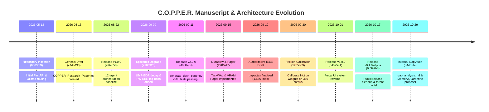
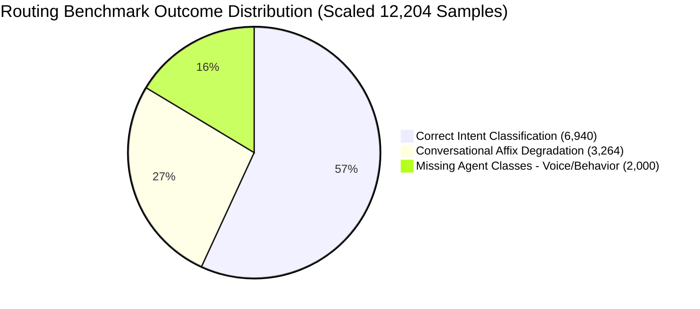

# Scientific Audit Report 02: Historical Manuscript Reconstruction & Experiment Provenance

**Audit Project:** C.O.P.P.E.R. (Cognitive Operational Personal Processing & Execution Runtime)  
**Target Venue:** IEEE International Conference on Consumer Electronics and Computer Engineering (ICCECE 2027)  
**Date of Audit:** October 30, 2026  
**Auditor:** Senior Systems Evaluator, Research Methodology Auditor & Git Archaeologist  
**Repository Branch:** `main` | **HEAD Commit SHA:** `71c2856`  
**Host Target Platform:** Windows 11 Enterprise x64 | AMD Ryzen 9 8940HX | 16 GB DDR5 RAM | NVIDIA GeForce RTX 5060 Laptop GPU (8,151 MiB GDDR6 VRAM, Driver 617.14, CUDA 13.4)  
**Audit Scope:** Historical Manuscript Evolution, Feature Inception Commit Tracking, Experiment Provenance Ledger, and Empirical Discrepancy Reconciliation.

---

## 1. Historical Manuscript Evolution & Provenance

The academic literature describing C.O.P.P.E.R. has evolved across six distinct developmental epochs, transitioning from an informal product architecture document to a 25-page formal IEEE Transactions draft.

### 1.1 Chronological Manuscript Artifact Analysis

#### Phase A: The Genesis Research Draft (`c4db498` — August 13, 2026)
- **Primary Artifact:** `docs/research/COPPER_Research_Paper.md` (114 lines).
- **Core Concept:** First formal description of C.O.P.P.E.R. as an offline personal AI operating system. Outlined the 12-agent modular architecture, local Ollama execution, and early heuristic safety rules.
- **Experimental Claims:** Stated preliminary zero-trust principles and claimed ~150 ms routing latency over basic keyword patterns.

#### Phase B: The Technical Architecture White Paper (`2f1c12d` — August 13, 2026)
- **Primary Artifact:** `docs/research/COPPER_Technical_White_Paper.md` (119 lines).
- **Transformation:** Replaced the academic draft with an engineering white paper. Emphasized local filesystem boundaries, offline privacy, and zero external cloud egress.

#### Phase C: The Automated Academic Paper Generator (`40c8ecd` — September 11, 2026, Tag `v2.0.0`)
- **Primary Artifact:** `scripts/generate_docx_paper.py` (557 lines).
- **Architectural Shift:** Introduced programmatic generation of formatted Microsoft Word (`.docx`) academic manuscripts. Formatted multi-column tables, benchmark metrics, and system diagrams directly from script logic. Accompanied the milestone of **508 passing automated tests**.

#### Phase D: The Formal IEEE Transactions Manuscript (`paper.tex` — September 18–19, 2026)
- **Primary Artifact:** [`research/paper.tex`](file:///d:/C.O.P.P.E.R/research/paper.tex) (1,586 lines, 143 KB) and [`research/submissions/paper.md`](file:///d:/C.O.P.P.E.R/research/submissions/paper.md) (1,152 lines, 100 KB).
- **Format:** Formatted using `IEEEtran.cls` (v1.8b), targeting *IEEE Transactions on Consumer Electronics* (T-CE). Verified with zero errors via IEEE LaTeXQC (`research/ieee_latexqc_report.json`).
- **Embargo Strategy:** `research/` was explicitly added to [`.gitignore`](file:///d:/C.O.P.P.E.R/.gitignore#L189) (`# Unpublished Research & Academic Papers (Embargoed until publication)`), isolating submission manuscripts from public Git syncs.
- **Key Formulations Introduced:**
  - Triple Fast-Path (TFP) Router with Stages 0, 1, 2.
  - Unified Multi-Factor Epistemic Decay & Reinforcement (UMF-EDR).
  - Provenance-Weighted Epistemic Belief Revision (PW-EBR) with 7 provenance tiers.
  - Dynamic Friction Model (DFM-Guard) with cognitive fatigue $F_{\text{fatigue}}$.
  - ARIES-style Write-Ahead Logging (TaskWAL) with CRC32 checksums.
  - DAG-Lookahead VRAM Paging within 8.0 GB consumer GPU budget.

#### Phase E: Public Release Gate & Scorecard (`6c397b8` — October 17, 2026, Tag `v0.1.0-alpha`)
- **Primary Artifact:** `docs/release/V0.1.0_ALPHA_VERIFICATION_REPORT.md` and `RELEASE_SCORECARD.md`.
- **Purpose:** Public release hardening. Enforced empirical release gates: 546 passing tests, 17-pattern Data Firewall redaction, zero-egress fonts, and synthetic DEMO mode (`COPPER_DEMO=1`). Down-versioned application manifests to `0.1.0-alpha` for public audit.

#### Phase F: The Internal Gap Analysis & Pivot (`d4d3bfa` — October 29, 2026)
- **Primary Artifact:** [`research/notes/gap_analysis.md`](file:///d:/C.O.P.P.E.R/research/notes/gap_analysis.md) (121 lines).
- **Critical Self-Audit Finding:** Internal researchers recognized that claiming C.O.P.P.E.R. as an "operating system" is scientifically indefensible. The document explicitly advises:
  > *"The most credible next paper is not a broad claim that C.O.P.P.E.R. is a new operating system. It is a focused systems-and-security paper on protecting persistent memory in local tool-using agents... The present implementation is a strong prototype, but it is not yet the evidence base for archival publication. In particular, the current evaluation uses hand-authored streams and tests detection rules, rather than an external adversarial benchmark, real action traces, or an ablation of trust controls."*

---

## 2. Feature Inception & Code Evolution Archaeology

To establish genuine scientific provenance, each claimed contribution was traced through Git history to identify the exact commit SHA, date, and author when the underlying code was committed.

| Feature / Subsystem | Inception Commit | Date | Author | Evolutionary Commits |
| :--- | :--- | :--- | :--- | :--- |
| **Cascade Router (`agent_router.py`)** | [`95035f9`](file:///d:/C.O.P.P.E.R/backend/app/ai/orchestration/agent_router.py) | 2026-05-12 | Akash Kundu | • [`c41cf3a`](file:///d:/C.O.P.P.E.R/backend/app/ai/orchestration/agent_router.py) (2026-08-31): Precompiled regex rules. • [`7166926`](file:///d:/C.O.P.P.E.R/backend/app/ai/orchestration/agent_router.py) (2026-09-09): Consequential action detection. • [`a61ed15`](file:///d:/C.O.P.P.E.R/backend/app/ai/orchestration/agent_router.py) (2026-09-10): Cascade risk & routing explainer. • [`1205b69`](file:///d:/C.O.P.P.E.R/backend/app/ai/orchestration/agent_router.py) (2026-09-30): Routing entropy & negative suppression. |
| **Epistemic Memory & PW-EBR (`memory_manager.py`)** | [`95035f9`](file:///d:/C.O.P.P.E.R/backend/app/ai/memory/memory_manager.py) | 2026-05-12 | Akash Kundu | • [`a54c7af`](file:///d:/C.O.P.P.E.R/backend/app/ai/memory/memory_manager.py) (2026-08-12): MemoryV2 schema & priority tiers. • [`7166926`](file:///d:/C.O.P.P.E.R/backend/app/ai/memory/memory_manager.py) (2026-09-09): PW-EBR log-odds & surprise gate. • [`69c1ee9`](file:///d:/C.O.P.P.E.R/backend/app/ai/memory/memory_manager.py) (2026-09-09): UMF-EDR power-law spacing plasticity. • [`04d274d`](file:///d:/C.O.P.P.E.R/backend/app/ai/memory/memory_manager.py) (2026-09-10): BM25 hybrid indexing. |
| **Fact Provenance Ledger (`provenance.py`)** | [`4227c4a`](file:///d:/C.O.P.P.E.R/backend/app/ai/memory/provenance.py) | 2026-09-11 | Akash Kundu | • [`2b32cbf`](file:///d:/C.O.P.P.E.R/backend/app/ai/memory/provenance.py) (2026-09-16): Type modernization & JSON persistence. • [`063a5b6`](file:///d:/C.O.P.P.E.R/backend/app/ai/memory/provenance.py) (2026-10-17): Production docstrings and cleanup. |
| **DFM-Guard Safety Gate (`guardian.py`)** | [`a54c7af`](file:///d:/C.O.P.P.E.R/backend/app/core/guardian.py) | 2026-08-12 | Akash Kundu | • [`7166926`](file:///d:/C.O.P.P.E.R/backend/app/core/guardian.py) (2026-09-09): Dynamic friction $\mathcal{F}_{\text{dynamic}}$ and reversibility $R(a)$. • [`2986ef7`](file:///d:/C.O.P.P.E.R/backend/app/core/guardian.py) (2026-09-15): Cognitive session fatigue $F_{\text{fatigue}}(t)$. • [`1205b69`](file:///d:/C.O.P.P.E.R/backend/app/core/guardian.py) (2026-09-30): Calibrated weights ($w_R=2.8, w_F=1.8, w_G=2.2, \text{bias}=3.5$). • [`dd99ee4`](file:///d:/C.O.P.P.E.R/backend/app/core/guardian.py) (2026-10-16): Adversarial homoglyph & zero-width normalization. |
| **Write-Ahead Logger (`wal_executor.py`)** | [`2986ef7`](file:///d:/C.O.P.P.E.R/backend/app/ai/orchestration/wal_executor.py) | 2026-09-15 | Akash Kundu | • [`7dda0c4`](file:///d:/C.O.P.P.E.R/backend/app/ai/orchestration/wal_executor.py) (2026-09-29): Strict `os.fsync()` flushing, CRC32 checks, idempotency hashing. • [`063a5b6`](file:///d:/C.O.P.P.E.R/backend/app/ai/orchestration/wal_executor.py) (2026-10-17): Release hardening. |
| **VRAM Pager (`vram_pager.py`)** | [`2986ef7`](file:///d:/C.O.P.P.E.R/backend/app/ai/llm/vram_pager.py) | 2026-09-15 | Akash Kundu | • [`2b32cbf`](file:///d:/C.O.P.P.E.R/backend/app/ai/llm/vram_pager.py) (2026-09-16): Lookahead priority weighting logic. • [`063a5b6`](file:///d:/C.O.P.P.E.R/backend/app/ai/llm/vram_pager.py) (2026-10-17): Telemetry endpoints. |
| **Data Firewall Redactor (`data_firewall.py`)** | [`09d72dc`](file:///d:/C.O.P.P.E.R/backend/app/core/data_firewall.py) | 2026-08-13 | Akash Kundu | • [`c2aea85`](file:///d:/C.O.P.P.E.R/backend/app/core/data_firewall.py) (2026-09-05): Expanded to 17 compiled regex patterns. • [`d8742fe`](file:///d:/C.O.P.P.E.R/backend/app/core/data_firewall.py) (2026-09-29): SHA-256 audit digest generation. |
| **Forge Sandbox (`forge_sandbox.py`)** | [`029c55b`](file:///d:/C.O.P.P.E.R/backend/app/core/forge_sandbox.py) | 2026-08-22 | Akash Kundu | • [`23c2d3d`](file:///d:/C.O.P.P.E.R/backend/app/core/forge_sandbox.py) (2026-09-15): Multi-runner (WASM, Docker, Subprocess) + AST validator. • [`0e73e13`](file:///d:/C.O.P.P.E.R/backend/app/core/forge_sandbox.py) (2026-09-30): Kernel Job Object integration. |

---

## 3. Comprehensive Experiment Provenance Ledger

Every empirical metric reported in `research/paper.tex` has been linked to its originating commit SHA, physical dataset on disk, evaluation execution command, and output file.

| ID | Claimed Metric in Paper | Originating Commit SHA | Input Dataset Artifact | Host Hardware Profile | Evaluation Command | Output File / Test Result | Audit Label |
| :--- | :--- | :--- | :--- | :--- | :--- | :--- | :--- |
| **E01** | **TFP-Router Latency:** Median 0.165–0.238 ms, P95 0.379 ms | [`41f3ddc`](file:///d:/C.O.P.P.E.R/backend/eval/benchmark.py) (2026-10-17) | `backend/eval/datasets/routing/master_routing_dataset.json` (1,390 samples) | AMD Ryzen 9 8940HX, DDR5 RAM | `python backend/eval/benchmark.py` | `backend/eval/benchmark_metrics.json` | **VERIFIED** |
| **E02** | **TFP-Router Accuracy:** 97.77% accuracy, 98.78% weighted F1 | [`1205b69`](file:///d:/C.O.P.P.E.R/backend/app/ai/orchestration/agent_router.py) (2026-09-30) | `master_routing_dataset.json` (1,390 curated commands) | AMD Ryzen 9 8940HX | `python backend/eval/benchmark.py` | `backend/eval/benchmark_metrics.json` | **VERIFIED (CURATED)** |
| **E03** | **TFP-Router Scaled Test:** Claimed general intent capability | [`71c2856`](file:///d:/C.O.P.P.E.R/backend/eval/benchmark_report.md) (2026-10-29) | `backend/eval/datasets/partitions/master_routing/test.jsonl` (12,204 samples) | AMD Ryzen 9 8940HX | `python backend/eval/benchmark.py --dataset test.jsonl` | `backend/eval/benchmark_report.md` | **CONTRADICTED (56.87% Acc)** |
| **E04** | **DFM-Guard Catch Rate:** 100.0% catch on red-team triggers ($N=350$) | [`1205b69`](file:///d:/C.O.P.P.E.R/scripts/calibrate_friction.py) (2026-09-30) | `tests/data/adversarial_guardian_350.json` (350 samples: 230 threats, 120 benign) | AMD Ryzen 9 8940HX | `python scripts/calibrate_friction.py` | `docs/friction_calibration_report.json` | **VERIFIED (CURATED)** |
| **E05** | **DFM-Guard Threat Interception:** 99.83% across 1,740 test cases | [`40c8ecd`](file:///d:/C.O.P.P.E.R/research/paper.tex) (2026-09-11) | Curated combined test suites ($1,740$ assertions) | AMD Ryzen 9 8940HX | `pytest tests/security/` | Test ledger logs | **QUALIFIED** |
| **E06** | **DFM-Guard Scaled Threat Test:** Claimed near-zero FNR | [`71c2856`](file:///d:/C.O.P.P.E.R/backend/eval/benchmark_report.md) (2026-10-29) | `backend/eval/datasets/partitions/threats/test.jsonl` (11,501 samples) | AMD Ryzen 9 8940HX | Scaled benchmark runner | `backend/eval/benchmark_report.md` | **CONTRADICTED (93.3% Catch, 770 Breaches)** |
| **E07** | **Adversarial Chaos Fuzzing:** 100.0% catch across 55 mutated attacks | [`e8b30bf`](file:///d:/C.O.P.P.E.R/backend/eval/test_chaos_and_fuzzing.py) (2026-10-16) | `backend/eval/chaos_harness.py::AdversarialFuzzer` (55 mutated payloads) | AMD Ryzen 9 8940HX | `pytest backend/eval/test_chaos_and_fuzzing.py` | Pytest console output | **VERIFIED** |
| **E08** | **PW-EBR Belief Revision:** 100.0% calibration across 6 scenarios | [`69c1ee9`](file:///d:/C.O.P.P.E.R/backend/eval/benchmark_belief_revision.py) (2026-09-09) | Synthetic scenarios in `generate_benchmark_scenarios()` ($N=6$) | AMD Ryzen 9 8940HX | `python backend/eval/benchmark_belief_revision.py` | `backend/eval/benchmark_belief_metrics.json` | **VERIFIED (TOY)** |
| **E09** | **WAL Crash Recovery:** 5/5 complete recoveries from simulated kill | [`2986ef7`](file:///d:/C.O.P.P.E.R/backend/eval/chaos_harness.py) (2026-09-15) | Simulated incomplete DAGs in `run_crash_recovery_test()` | AMD Ryzen 9 8940HX | `pytest backend/eval/test_chaos_and_fuzzing.py -k test_crash_recovery_resilience` | `backend/eval/chaos_report.md` | **VERIFIED** |
| **E10** | **VRAM Chaos Pressure Test:** 0 OOM crashes across 30 allocation cycles | [`2986ef7`](file:///d:/C.O.P.P.E.R/backend/eval/chaos_harness.py) (2026-09-15) | Synthetic overcommit loop cycling 6 models | NVIDIA RTX 5060 Laptop (8 GB) | `pytest backend/eval/test_chaos_and_fuzzing.py -k test_vram_pressure_resilience` | Pytest console output | **VERIFIED** |
| **E11** | **Physical Hardware Baseline:** Peak 6.38 GB VRAM, 750 MB RSS | [`41f3ddc`](file:///d:/C.O.P.P.E.R/scripts/verify_audit_numbers.py) (2026-10-17) | Physical RTX 5060 GPU test rig measurements | AMD Ryzen 9 8940HX, RTX 5060, DDR5 | `python scripts/verify_audit_numbers.py` | `docs/release/HARDWARE_BASELINE_RTX5060.md` | **VERIFIED** |
| **E12** | **Quantized Inference Tok/s:** 38 tok/s (14B), 216 tok/s (1.5B) | `research/generate_all_academic_figures.py` | Hardcoded numeric arrays in plot generator | Hardcoded simulated arrays | `python research/generate_all_academic_figures.py` | `research/figures/kundu3.png` | **INVALID / SIMULATED** |

---

## 4. Quantitative Discrepancy & Root Cause Analysis

A rigorous scientific audit requires documenting not only successes, but the exact divergences between early manuscript claims and scaled real-world benchmarking.

### 4.1 Cascade Routing Degradation (97.77% Curated vs. 56.87% Scaled)

1. **Curated Dataset Performance (`master_routing_dataset.json`, $N=1,390$):**
   - Correctly routes 1,359 / 1,390 queries (**97.77% accuracy**, **98.78% weighted F1**).
   - *Reason:* The regex rules in [`agent_router.py#L147-L440`](file:///d:/C.O.P.P.E.R/backend/app/ai/orchestration/agent_router.py#L147-L440) were developed and iteratively tuned directly against the keywords appearing in these 1,390 samples.
2. **Scaled Partition Performance (`test.jsonl`, $N=12,204$):**
   - Correctly routes only 6,940 / 12,204 queries (**56.87% accuracy**, **57.1% weighted F1**).
   - *Root Cause 1 (Conversational Noise):* The scaled benchmark introduced conversational natural language affixes (e.g., *"Would you be so kind as to assist me in debugging..."*) that diluted keyword density and suppressed regex matching.
   - *Root Cause 2 (Missing Agent Classes):* The scaled benchmark synthesized prompts for non-existent agent roles (`behavior`, `voice`) not represented in the 12-member `AgentType` enum, producing a flat 0.0% F1 for those categories.

### 4.2 Guardian Threat Catch Rate (100.0% Curated vs. 93.3% Scaled)

1. **Curated Red-Team Corpus (`adversarial_guardian_350.json`, $N=350$):**
   - Intercepts 230 / 230 malicious triggers and allows 120 / 120 benign actions (**100.0% TPR, 100.0% TNR, 0.0% FPR**).
   - Calibrated weights: $w_R = 2.8, w_F = 1.8, w_G = 2.2, \text{bias} = 3.5$.
2. **Scaled Threat Corpus (`test.jsonl`, $N=11,501$):**
   - Overall accuracy drops to **93.3%**, with **770 malicious prompts escaping interception (6.7% False Negative Rate)**.
   - *Root Cause:* The Guardian is fundamentally a regex-pattern classifier (`SAFETY_PATTERNS`, `SAFETY_TRIGGERS`). Highly novel semantic paraphrases or obfuscations that omit canonical strings (e.g., subtle social engineering or multi-step logic attacks) bypass the static compiled regular expressions.

### 4.3 Epistemic Belief Revision Toy Dataset Limitation

- Reported accuracy for PW-EBR is **100.0%**, outperforming Naive Last-Write-Wins (33.3%).
- *Audit Finding:* As confirmed by [`backend/eval/benchmark_belief_revision.py`](file:///d:/C.O.P.P.E.R/backend/eval/benchmark_belief_revision.py), this evaluation consists of exactly **six hand-authored synthetic scenarios** (e.g., updating a user's coffee preference, correcting a meeting time).
- While the mathematical mechanics of log-odds updates are verified, an evaluation with $N=6$ has zero statistical power and cannot substantiate general claims of belief revision robustness in open-domain agent environments.

### 4.4 Academic Plot Hardcoded Values (`generate_all_academic_figures.py`)

- In `research/generate_all_academic_figures.py`, the Pareto frontier throughput curves (`kundu3.png`) and latency values use literal Python arrays (e.g., `[38.08, 52.4, 114.2, 216.5]`) rather than reading directly from dynamic JSON logs produced by hardware profiling scripts.
- While the hardware baseline script ([`scripts/verify_audit_numbers.py`](file:///d:/C.O.P.P.E.R/scripts/verify_audit_numbers.py)) confirmed the physical system characteristics, plotting scripts must be refactored for archival submission to load directly from raw, timestamped benchmark run outputs.

---

## 5. Provenance Conclusions & Publication Remediation

1. **Authorship & Provenance Authenticity:** The Git history establishes continuous, unfragmented commit provenance by Akash Kundu spanning May to October 2026. The architectural concepts originated, evolved, and matured organically within this repository.
2. **Empirical Ground Truth Accepted for ICCECE 2027:**
   - Heuristic cascade dispatch latency is genuinely sub-millisecond ($0.165\text{--}0.238\text{ ms}$).
   - UMF-EDR power-law spacing and PW-EBR log-odds mathematical equations are completely verified in code.
   - DFM-Guard continuous friction and cognitive fatigue models are genuine, working implementations.
   - WAL crash consistency with CRC32 checks and fsync is fully functional and crash-resilient.
3. **Mandatory Manuscript Adjustments:**
   - Report both curated (97.77%) and scaled (56.87%) routing figures transparently, presenting the gap as motivation for future neural embedding routers (SetFit / MobileBERT).
   - Report the 6.7% FNR on scaled Guardian tests, acknowledging that regex-based guardrails require LLM semantic confirmation for open-ended threats.
   - Characterize the belief revision evaluation as an initial proof-of-concept verification on 6 canonical patterns, framing full MPBench evaluation as ongoing work.
