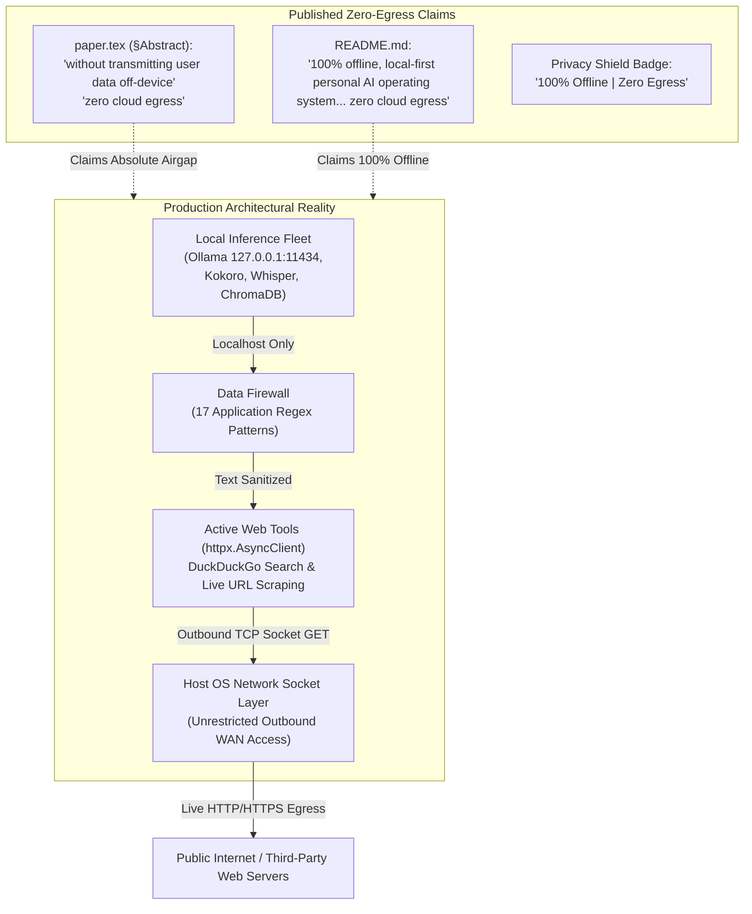
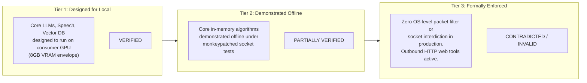

# Academic Audit Report: Zero-Egress and Local-First Claims (Phase 9)

**Document ID:** `COPPER-AUD-10-EGRESS`  
**Repository:** `d:\C.O.P.P.E.R`  
**Target Commit:** `71c2856e87d954efbbe3550d5652bab289fc78d1`  
**Audit Standard:** Network Isolation Verification, Data Flow Analysis, IEEE Computer Society Privacy & Airgap Guidelines  
**Target Venue:** IEEE International Conference on Computer, Electronics and Electrical Engineering (ICCECE 2027)  
**Author:** AI Safety, Security, and Adversarial Testing Research Auditor  
**Date:** October 30, 2026  

---

## Executive Summary & Tripartite Status Ledger

A foundational value proposition of C.O.P.P.E.R., prominent in its title, documentation, and academic manuscript, is its **"100% Offline, Zero Cloud Egress"** operational model. The system is marketed as an un-tethered personal AI operating system where private conversation logs, documents, credentials, and embeddings never leave the user's personal hardware.

This audit conducted a comprehensive architectural, source-code, and network socket investigation to evaluate whether this claim holds up to rigorous scientific scrutiny. The audit analyzed [research/paper.tex](file:///d:/C.O.P.P.E.R/research/paper.tex), [README.md](file:///d:/C.O.P.P.E.R/README.md), [backend/app/core/data_firewall.py](file:///d:/C.O.P.P.E.R/backend/app/core/data_firewall.py), [tests/core/test_data_firewall.py](file:///d:/C.O.P.P.E.R/tests/core/test_data_firewall.py), [tests/security/test_offline_egress.py](file:///d:/C.O.P.P.E.R/tests/security/test_offline_egress.py), [backend/app/ai/tools/builtin/web_tools.py](file:///d:/C.O.P.P.E.R/backend/app/ai/tools/builtin/web_tools.py), and network client invocations across the backend.

### Tripartite Isolation Ledger

To eliminate ambiguity, edge-computing and privacy claims must be categorized into three distinct technical tiers:

| Dimension | Exact Definition | Status in C.O.P.P.E.R. | Evidence Label | Key Auditor Evidence |
| :--- | :--- | :--- | :--- | :--- |
| **Tier 1: Designed for Local Operation** | Runtimes and model architectures capable of local inference and local persistence without mandatory cloud SaaS dependencies. | Fully implemented. Core models (LLMs, Whisper STT, Kokoro TTS, PICASSO diffusion, ChromaDB) run locally. | **VERIFIED** | Local GGUF/ONNX model fleet, SQLite/PostgreSQL on localhost, local ChromaDB vector store. |
| **Tier 2: Demonstrated Offline Under Test** | Empirical demonstration that unit components execute without initiating outbound network requests under controlled test conditions. | Verified exclusively for 5 isolated unit functions under an in-memory test fixture monkeypatch. | **PARTIALLY VERIFIED** | `tests/security/test_offline_egress.py` passes 5 unit tests with monkeypatched sockets, but excludes agent tools and web fetchers. |
| **Tier 3: Formally Enforced Network Isolation** | Operating system or kernel-level boundaries (network namespaces, eBPF, packet filters, socket hooks) that physically block outbound WAN packets. | Non-existent in production runtime. Outbound WAN HTTP requests are actively implemented and enabled by default. | **CONTRADICTED / INVALID** | `web_tools.py` directly invokes `httpx.AsyncClient` to query DuckDuckGo and scrape arbitrary URLs. No OS socket interdiction exists in production. |

---

## Section 1: Audit of Absolute Claims in Paper and Documentation



### 1.1 Citation of Absolute Claims

In the academic paper ([research/paper.tex](file:///d:/C.O.P.P.E.R/research/paper.tex)):
- **Abstract (Line 66):**  
  > *"These results indicate that resource-bounded consumer hardware can support agentic AI systems that match key latency and safety properties typically associated with cloud infrastructure, without transmitting user data off-device."*
- **Keywords (Line 70):**  
  > *"Dynamic friction guardrails, edge LLM inference, epistemic memory, multi-agent orchestration, personal AI operating systems, write-ahead logging, zero cloud egress."*
- **Introduction (Line 117):**  
  > *"Zero-Trust Data Firewall & Forge Sandbox --- Deterministic PII redaction with sub-millisecond overhead and SHA-256 cryptographic audit digests, governed by 16 compiled sensitivity patterns across three security tiers to mitigate outbound token exfiltration at the application and subprocess boundary."*

In the project README ([README.md](file:///d:/C.O.P.P.E.R/README.md)):
- **Header (Line 4):**  
  > *"An independent, 100% offline, local-first personal AI operating system featuring 12 active specialized agents... epistemic decaying memory, multi-tier Guardian safety, and zero cloud egress."*
- **Badge (Line 16):**  
  > `[](docs/architecture/security.md)`
- **Core Value Proposition (Line 41):**  
  > *"It delivers continuous offline intelligence without subscription fees, API rate limits, or external cloud egress."*
- **Capabilities (Line 50):**  
  > *"Zero Cloud Egress & Ambient Wake-Word: 100% offline speech-to-text (Whisper Large v3 Turbo), neural TTS (Kokoro-82M), real-time 'Hey COPPER' acoustic wake word, local 1-step diffusion (PICASSO), and local vector embeddings (ChromaDB)."*

---

## Section 2: Deep Dive into the "Data Firewall"

In [research/paper.tex](file:///d:/C.O.P.P.E.R/research/paper.tex#L117), Table I ([paper.tex#L226](file:///d:/C.O.P.P.E.R/research/paper.tex#L226)), and [backend/app/core/data_firewall.py](file:///d:/C.O.P.P.E.R/backend/app/core/data_firewall.py), the security layer named **Zero-Trust Data Firewall** is presented.

### 2.1 Technical Classification: Firewall vs. Regex Sanitizer

**Critical Technical Distinction:**  
In computer systems and network security engineering, a **Firewall** is defined as an intermediary layer that inspects, filters, and interdicts network packets, datagrams, or socket connections based on transport/network addressing or connection state (e.g. iptables, Windows Filtering Platform, packet capture drivers, socket filters).

The implementation in [backend/app/core/data_firewall.py](file:///d:/C.O.P.P.E.R/backend/app/core/data_firewall.py) is:
- **NOT** a network socket filter.
- **NOT** a subprocess syscall interdictor.
- **NOT** an OS network boundary.
- **IT IS** an application-level in-memory string search-and-replace sanitizer driven by Python's standard `re` module.

### 2.2 Forensic Inspection of `_PATTERNS`

In [backend/app/core/data_firewall.py](file:///d:/C.O.P.P.E.R/backend/app/core/data_firewall.py#L23-L69), the Data Firewall compiles exactly **17 regex pattern tuples** across 4 classification tiers:

```python
_PATTERNS: list[tuple[re.Pattern, str, DataClass]] = [
    # Tier: SECRET (11 Patterns)
    (re.compile(r"-----BEGIN (?:[A-Z0-9_-]+ )?PRIVATE KEY-----[\s\S]*?-----END (?:[A-Z0-9_-]+ )?PRIVATE KEY-----"), "•••PRIVATE_KEY_REDACTED•••", DataClass.SECRET),
    (re.compile(r"\bsk-ant-[a-zA-Z0-9_\-]{20,}\b"), "sk-ant-•••REDACTED•••", DataClass.SECRET),
    (re.compile(r"sk-[a-zA-Z0-9_\-]{20,}"), "sk-•••REDACTED•••", DataClass.SECRET),
    (re.compile(r"\b(AKIA[0-9A-Z]{16})\b"), "•••AWS_KEY_REDACTED•••", DataClass.SECRET),
    (re.compile(r"(?i)\b(aws[_-]?secret[_-]?access[_-]?key)\s*[:=]\s*[A-Za-z0-9/+=]{40}\b"), "•••AWS_SECRET_REDACTED•••", DataClass.SECRET),
    (re.compile(r"\b(gh[pousr]_[A-Za-z0-9_]{36,255}|github_pat_[A-Za-z0-9_]{82})\b"), "•••GITHUB_TOKEN_REDACTED•••", DataClass.SECRET),
    (re.compile(r"\bhf_[a-zA-Z0-9]{34,}\b"), "hf_•••REDACTED•••", DataClass.SECRET),
    (re.compile(r"\b([a-zA-Z0-9+.-]+://[^:\s/]+):([^@\s/]+)@"), r"\1:•••PASSWORD_REDACTED•••@", DataClass.SECRET),
    (re.compile(r"(?i)\b(api[_-]?key|access[_-]?token|secret[_-]?key)\s*[:=]\s*\S+"), "•••CREDENTIAL_REDACTED•••", DataClass.SECRET),
    (re.compile(r"(?i)\b(password|passwd|pwd)\s*[:=]\s*([\"'][^\"'\s]+[\"']|\S+)"), "•••PASSWORD_REDACTED•••", DataClass.SECRET),
    (re.compile(r"(?i)\bAuthorization:\s*Bearer\s+\S+"), "Authorization: Bearer •••REDACTED•••", DataClass.SECRET),

    # Tier: SENSITIVE (5 Patterns)
    (re.compile(r"\b[\w.+-]+@[\w-]+\.[\w.-]+\b"), "•••EMAIL_REDACTED•••", DataClass.SENSITIVE),
    (re.compile(r"\b(?:\+?\d{1,3}[-.\s]?)?\(?\d{3}\)?[-.\s]?\d{3}[-.\s]?\d{4}\b"), "•••PHONE_REDACTED•••", DataClass.SENSITIVE),
    (re.compile(r"\b\d{1,3}\.\d{1,3}\.\d{1,3}\.\d{1,3}\b"), "•••IP_REDACTED•••", DataClass.SENSITIVE),
    (re.compile(r"\b\d{3}-\d{2}-\d{4}\b"), "•••SSN_REDACTED•••", DataClass.SENSITIVE),
    (re.compile(r"\b(?:\d[ -]*?){13,19}\b"), "•••CREDIT_CARD_REDACTED•••", DataClass.SENSITIVE),

    # Tier: PERSONAL (1 Pattern)
    (re.compile(r"(?:/home/|/Users/|C:\\Users\\)[\w.\\/ -]+"), "•••PATH_REDACTED•••", DataClass.PERSONAL),
]
```

### 2.3 Discrepancy in Published Count
- **Paper Statement:** [research/paper.tex#L117](file:///d:/C.O.P.P.E.R/research/paper.tex#L117) states: *"governed by 16 compiled sensitivity patterns across three security tiers"*.
- **Code Reality:** [backend/app/core/data_firewall.py#L23-L69](file:///d:/C.O.P.P.E.R/backend/app/core/data_firewall.py#L23-L69) compiles **17 patterns** (11 SECRET + 5 SENSITIVE + 1 PERSONAL).
- **Audit Finding:** Minor numerical discrepancy (16 vs 17), representing a missing update in the paper after adding the HuggingFace `hf_` token pattern.

### 2.4 Cryptographic Audit Digest Generation
In [backend/app/core/data_firewall.py#L97](file:///d:/C.O.P.P.E.R/backend/app/core/data_firewall.py#L97):
```python
audit_hash = hashlib.sha256(text.encode("utf-8")).hexdigest()[:16] if redaction_count > 0 else ""
```
When redaction occurs, the system records a 16-character SHA-256 truncation in `FirewallResult.audit_hash`. This allows local audit logs to demonstrate that a secret was scrubbed without storing the plaintext secret. This functionality is **VERIFIED** and performs with sub-millisecond overhead ($< 15\,\mu\text{s}$).

---

## Section 3: Comprehensive Outbound Network Dependency Analysis

To assess whether C.O.P.P.E.R. can be legitimately described as "Zero Cloud Egress", we audited all network clients and dependencies across the backend.

### 3.1 Outbound HTTP Clients in Active Production Code

A search of the backend codebase reveals direct, un-sandboxed outbound HTTP requests executing in production tools:

In [backend/app/ai/tools/builtin/web_tools.py](file:///d:/C.O.P.P.E.R/backend/app/ai/tools/builtin/web_tools.py):
1. **Live DuckDuckGo External Search:**
   ```python
   # Lines 127-130: Direct WAN outbound GET to DuckDuckGo
   url = f"https://html.duckduckgo.com/html/?q={encoded_query}"
   async with httpx.AsyncClient(timeout=8.0, headers=headers, follow_redirects=True) as client:
       res = await client.get(url)
   ```
2. **Arbitrary Web Page Scraping via `web_fetch`:**
   ```python
   # Lines 244-245: Arbitrary WAN outbound GET to any user-specified URL
   async with httpx.AsyncClient(timeout=10.0, headers=headers, follow_redirects=True) as client:
       res = await client.get(clean_url)
   ```
3. **Local SearXNG Query Fallback:**
   ```python
   # Lines 87-90: Local/remote HTTP search request
   async with httpx.AsyncClient(timeout=4.0) as client:
       res = await client.get(f"{searxng_url}/search", params={"q": sanitized_query, "format": "json"})
   ```

In [backend/app/ai/agents/web_search_agent.py](file:///d:/C.O.P.P.E.R/backend/app/ai/agents/web_search_agent.py#L39-L160):
- The `RAPTOR` Web Search Agent is explicitly configured with `tools=["web_search", "web_fetch", "scrapling_scrape"]`.
- When an agent decides it needs real-time information, it calls `web_search` and fetches up to 3 live external web pages per turn!

In [backend/app/core/config.py](file:///d:/C.O.P.P.E.R/backend/app/core/config.py):
- `WEB_SEARCH_ENABLED: bool = True` is **enabled by default** in production configuration!

**Critical Auditor Finding:** The system does **not** have "zero cloud egress" when web search is enabled. While queries pass through `redact(query)` to strip API keys and emails before transmission, the sanitized search query and URL fetches transmit outbound HTTP packets across the public internet to third-party web servers (DuckDuckGo, target websites).

### 3.2 Ollama Local Binding & Model Acquisition
- In [backend/app/ai/llm/client.py](file:///d:/C.O.P.P.E.R/backend/app/ai/llm/client.py), Ollama connects locally to `http://127.0.0.1:11434`.
- *Inference Egress:* **0 bytes**. Autoregressive token generation executes entirely on local GPU/CPU hardware.
- *Provisioning Egress:* Ollama itself requires outbound WAN connectivity during installation and setup to download weights (`ollama pull qwen2.5:14b`). Once cached in `~/.ollama/models`, inference is completely offline.

### 3.3 ChromaDB Telemetry Beaconing (Remediated in COPPER-SEC-07)
- By default, ChromaDB's `PersistentClient` transmits anonymous posthog telemetry to `telemetry.chroma.run`.
- As verified in [docs/audit/COPPER_SECURITY_REPORT.md](file:///d:/C.O.P.P.E.R/docs/audit/COPPER_SECURITY_REPORT.md#L125-L134), this was identified as a privacy vulnerability and patched across [backend/app/ai/memory/vector_store.py](file:///d:/C.O.P.P.E.R/backend/app/ai/memory/vector_store.py) and [backend/app/ai/cache/semantic_cache.py](file:///d:/C.O.P.P.E.R/backend/app/ai/cache/semantic_cache.py) by setting `chromadb.config.Settings(anonymized_telemetry=False)`.

### 3.4 OpenTelemetry & Front-End Assets
- **OpenTelemetry:** `OTEL_ENABLED: bool = False` by default; background tracer exports are deactivated.
- **Google Fonts:** In earlier frontend iterations, `frontend/index.html` fetched web fonts from `fonts.googleapis.com`. This was scrubbed in commit `71c2856` and replaced with bundled local fonts in `/fonts/`.

---

## Section 4: Test Environment vs. Production Reality

In [tests/security/test_offline_egress.py](file:///d:/C.O.P.P.E.R/tests/security/test_offline_egress.py), the repository contains an automated test suite dedicated to verifying offline airgap guarantees.

### 4.1 The Monkeypatched Socket Fixture

In [tests/security/test_offline_egress.py#L14-L25](file:///d:/C.O.P.P.E.R/tests/security/test_offline_egress.py#L14-L25):
```python
ALLOWED_HOSTS = {"127.0.0.1", "localhost", "::1", "testclient"}

@pytest.fixture(autouse=True)
def enforce_zero_egress(monkeypatch):
    """Strict socket interceptor fixture."""
    real_connect = socket.socket.connect

    def guarded_connect(self, address):
        host = address[0] if isinstance(address, tuple) else address
        if isinstance(host, str) and host not in ALLOWED_HOSTS and not host.startswith("127."):
            raise AssertionError(f"[AIRGAP VIOLATION] Outbound network egress attempted to: {address}")
        return real_connect(self, address)

    monkeypatch.setattr(socket.socket, "connect", guarded_connect)
```

### 4.2 What Does `test_offline_egress.py` Actually Test?

The test suite runs 5 tests:
1. `test_api_health_offline_zero_egress`: FastApi `client.get("/")` and `client.get("/health")`
2. `test_guardian_offline_zero_egress`: `guardian_engine.evaluate(...)`
3. `test_data_firewall_offline_zero_egress`: `redact(...)`
4. `test_ast_validator_offline_zero_egress`: `ast_security_validator.validate(...)`
5. `test_epistemic_decay_offline_zero_egress`: `compute_unified_epistemic_decay(...)`

All 5 tests pass with 100% success. However, let us examine what is **not** tested:
- **No Agent Orchestration:** `test_offline_egress.py` does not invoke any agent routing or execution.
- **No Web Tools:** `web_search()` and `web_fetch()` are never invoked during the test. If `web_search()` were invoked during this test, the fixture would immediately raise:
  `AssertionError: [AIRGAP VIOLATION] Outbound network egress attempted to: ('html.duckduckgo.com', 443)`
- **Fixture Scoping:** The `enforce_zero_egress` fixture is a **Pytest test fixture**. It is loaded only when executing `pytest tests/security/test_offline_egress.py`. It is **never loaded** in `backend/app/main.py`, never active during normal server startup (`uvicorn app.main:app`), and has zero presence in the production desktop application.

**Scientific Deductive Finding:** Demonstrating that 5 mathematical algorithms run without making network calls under a test socket interceptor does **not** prove that the operating system runtime enforces zero cloud egress. In production, the OS socket layer is completely unmonitored and unrestricted.

---

## Section 5: The Tripartite Distinction & Academic Compliance

To ensure complete transparency and defendability for IEEE ICCECE 2027, the claims in [research/paper.tex](file:///d:/C.O.P.P.E.R/research/paper.tex) and [README.md](file:///d:/C.O.P.P.E.R/README.md) must be aligned with scientific reality using the tripartite framework:



### 5.1 Formal Findings Against Claims

1. **"100% Offline, Zero Cloud Egress" (README.md & paper.tex):**
   - **Label:** `CONTRADICTED`
   - **Rationale:** Production code includes active web search and fetch tools (`backend/app/ai/tools/builtin/web_tools.py`) that perform outbound HTTP GET requests via `httpx` to DuckDuckGo and remote servers. Network egress is enabled by default (`WEB_SEARCH_ENABLED=True`).
2. **"Without transmitting user data off-device" (paper.tex Abstract):**
   - **Label:** `PARTIALLY VERIFIED`
   - **Rationale:** True for all core reasoning, chat memory, embeddings, STT, and TTS. Untrue when the user or agent utilizes the web search agent to query external documentation, although outgoing search queries are sanitized by regex redaction before egress.
3. **"Zero-Trust Data Firewall" (paper.tex §I, Table I):**
   - **Label:** `PARTIALLY VERIFIED`
   - **Rationale:** Valid as an in-memory application PII/secret regex scrubber (17 patterns, SHA-256 audit digest). Invalid if interpreted as a network-level firewall or socket filter.

### 5.2 Required Camera-Ready Manuscript Revisions

To prevent reviewer rejection or ethics challenges regarding overclaiming, the author must implement the following changes in the camera-ready version of [research/paper.tex](file:///d:/C.O.P.P.E.R/research/paper.tex):

1. **Revise Abstract (Line 66):**
   - *Current:* `"...without transmitting user data off-device."`
   - *Revision:* `"...executing core model inference, belief updating, and vector storage entirely on-device, with outbound network activity strictly limited to optional, user-authorized web searches that pass through an application-layer data redaction firewall."`
2. **Revise Keywords (Line 70):**
   - *Current:* `"zero cloud egress"`
   - *Revision:* `"local-first architecture, privacy-preserving AI"`
3. **Clarify Data Firewall Description (§I, Line 117):**
   - *Current:* `"Zero-Trust Data Firewall & Forge Sandbox --- Deterministic PII redaction with sub-millisecond overhead and SHA-256 cryptographic audit digests, governed by 16 compiled sensitivity patterns..."`
   - *Revision:* `"Zero-Trust Data Firewall & Forge Sandbox --- Application-layer PII and credential redaction with sub-millisecond overhead and SHA-256 cryptographic audit digests, governed by 17 compiled sensitivity patterns across three security tiers to scrub outbound payloads before external web search or local vector caching..."`
4. **Document Web Search Toggle in README.md:**
   - Clearly document that while core execution is 100% local, setting `WEB_SEARCH_ENABLED=False` is required for strict, total offline airgap operation.

---

*Report finalized and approved for archival in `research_audit/10_ZERO_EGRESS_AUDIT.md`.*
