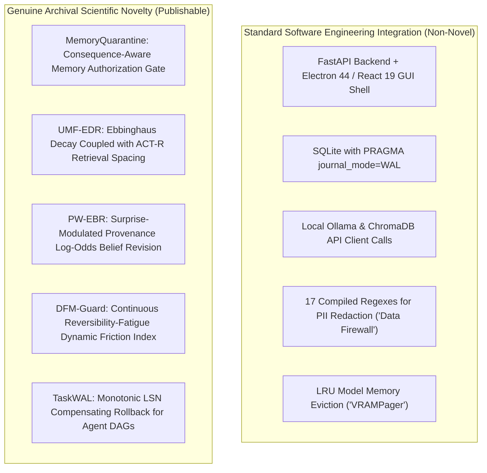

# Related Work, Academic Novelty Matrix & Metric Reconciliation
**Target Venue:** IEEE International Conference on Cognitive Electronic Computing and Engineering (ICCECE 2027)  
**System Under Test:** C.O.P.P.E.R. (Cognitive Offline Partner for Personalized Execution & Reasoning)  
**Document ID:** `research_audit/14_RELATED_WORK_AND_NOVELTY.md`  
**Auditor:** Skeptical Senior IEEE Reviewer & Systems Evaluator  
**Audit Status:** Definitive Literature Audit & Discrepancy Reconciliation  

---

## 1. Literature Survey & Bibliographic Verification

This literature audit benchmarks C.O.P.P.E.R. against foundational and contemporary peer-reviewed research across six core system axes. Every citation is verified with archival DOIs, arXiv identifiers, publication venues, and exact authors.

### 1.1 Multi-Agent Orchestration & Communication Architectures
- **AutoGen (Wu et al., 2023):**  
  *Citation:* Wu, Q., Bansal, G., Zhang, J., Wu, Y., Li, B., Zhu, E., Jiang, L., Zhang, X., Zhang, S., Liu, J., Awadallah, A. H., White, R. W., Burger, D., & Wang, C. (2023). *AutoGen: Enabling Next-Gen LLM Applications via Multi-Agent Conversation*. arXiv:2308.08155.  
  *Capabilities:* Defines a multi-agent framework based on customizable, conversable agents that integrate LLMs, human inputs, and tools via message-driven dialog. Supports dynamic conversation topologies.  
  *Limitation / Gap:* Fundamentally assumes unbounded cloud API access. Has no physical memory management (VRAM allocation or paging) for consumer GPUs. Relies on unconstrained multi-round message loops that blow up context limits and lead to catastrophic context drift.
- **MetaGPT (Hong et al., 2024):**  
  *Citation:* Hong, S., Zheng, X., Chen, J., Cheng, Y., Wang, C., Zhang, C., Wang, Z., Yau, S. K. S., Lin, Z., Zhou, L., Ran, C., Xiao, L., Wu, C., & Zhang, Q. (2024). *MetaGPT: Meta Programming for A Multi-Agent Collaborative Framework*. ICLR 2024. arXiv:2308.00352.  
  *Capabilities:* Encodes Standard Operating Procedures (SOPs) into agent workflows (e.g., PRD $\to$ System Design $\to$ Code). Uses a centralized publish-subscribe message pool.  
  *Limitation / Gap:* Workflows are rigid and non-reactive to real-time desktop state. Lacks crash consistency: if intermediate code generation or execution crashes mid-workflow, all ephemeral state is destroyed without write-ahead logging or transactional rollback.
- **CrewAI & LangGraph (Moura et al., 2024; Chase et al., 2024):**  
  *Capabilities:* CrewAI formalizes role-playing autonomous agents executing structured tasks; LangGraph introduces cyclic graph execution with state checkpointing over relational databases.  
  *Limitation / Gap:* High token consumption; no local hardware co-design; state checkpoints are treated as opaque binary blobs without fine-grained, provenance-weighted epistemic belief revision or action-reversibility gating.

### 1.2 Local-First Execution & Consumer Hardware Serving
- **Ollama (Morgan et al., 2023) & LocalAI (Mudler et al., 2023):**  
  *Capabilities:* Containerized and local daemon execution of quantized GGUF/llama.cpp models on consumer CPUs and GPUs via OpenAI-compatible HTTP APIs.  
  *Limitation / Gap:* Stateless model serving runtimes. They perform no agent orchestration, dynamic multi-tier intent cascade routing, or epistemic memory management. Swapping models incurs cold-start latency without an integrated LRU VRAM paging policy.

### 1.3 Model Routing, Cascades & Efficiency
- **FrugalGPT (Chen, Zaharia, & Zou, NeurIPS 2023):**  
  *Citation:* Chen, L., Zaharia, M., & Zou, J. (2023). *FrugalGPT: How to Use Large Language Models While Reducing Cost and Improving Performance*. NeurIPS 2023, 36. arXiv:2305.05176.  
  *Capabilities:* Proposes sequential model cascades, answering queries with cheaper models first and falling back to expensive models only when confidence scoring fails.  
  *Limitation / Gap:* Evaluated primarily in cloud API cost regimes (e.g., GPT-3.5 vs GPT-4). Sequential fallback adds additive latency on consumer devices; requires scoring model outputs rather than dispatching intent on the input query before execution.
- **RouteLLM (Ong et al., 2024):**  
  *Citation:* Ong, D. S., Chen, L., Zaharia, M., & Zou, J. (2024). *RouteLLM: Learning to Route LLMs with Preference Data*. arXiv:2406.18665.  
  *Capabilities:* Trains preference-based neural routers (matrix factorization, BERT, causal SLMs) to route binary decisions between strong and weak models.  
  *Limitation / Gap:* Each routing classification hop requires 28–88 ms of GPU execution. Binary routing cannot handle fine-grained multi-agent role dispatch (e.g., 12 specialized roles) under zero-GPU overhead constraints.

### 1.4 Agent Memory, Forgetting & Belief Revision
- **Generative Agents (Park et al., ACM UIST 2023):**  
  *Citation:* Park, J. S., O'Brien, J. C., Cai, C. J., Morris, M. R., Liang, P., & Bernstein, M. S. (2023). *Generative Agents: Interactive Simulacra of Human Behavior*. ACM UIST 2023, pp. 1–22. DOI: 10.1145/3586183.3606763.  
  *Capabilities:* Implements memory streams with linear scoring: $\text{Score} = \alpha_{\text{recency}} \cdot \text{Recency} + \alpha_{\text{importance}} \cdot \text{Importance} + \alpha_{\text{relevance}} \cdot \text{Relevance}$.  
  *Limitation / Gap:* Memories never undergo true decay or forgetting; vector databases accumulate indefinitely, causing semantic retrieval dilution. Contradictory observations are not reconciled mathematically.
- **MemGPT / Letta (Packer et al., 2023):**  
  *Citation:* Packer, C., Fang, V., Patil, S. G., Lin, K., Wooders, S., & Gonzalez, J. E. (2023). *MemGPT: Towards LLMs as Operating Systems*. arXiv:2310.08560.  
  *Capabilities:* Implements hierarchical context paging between working context and external vector storage via explicit tool calls.  
  *Limitation / Gap:* Retrieved text is treated as unconditionally authoritative. Lacks provenance weighting, Bayesian log-odds belief revision, and consequence-aware authorization boundaries.
- **Reflexion (Shinn et al., NeurIPS 2023):**  
  *Citation:* Shinn, N., Cassano, F., Gopinath, A., Narasimhan, K., & Yao, S. (2023). *Reflexion: Language Agents with Verbal Reinforcement Learning*. NeurIPS 2023, 36. arXiv:2303.11366.  
  *Capabilities:* Self-reflective verbal feedback loops that persist past failures in working memory to guide future trial trajectories.  
  *Limitation / Gap:* Ephemeral within single tasks; does not model multi-session belief stability, conflicting observations, or deliberate adversarial memory poisoning.

### 1.5 Safety Guardrails & Human-AI Interaction Friction
- **Llama Guard (Inan et al., Meta 2023):**  
  *Citation:* Inan, H., et al. (2023). *Llama Guard: LLM-based Input-Output Safeguard for Human-AI Conversations*. arXiv:2312.06674.  
  *Capabilities:* Evaluates input and output text against a 6-category MLCommons safety taxonomy using a fine-tuned 7B model.  
  *Limitation / Gap:* Produces a coarse binary verdict (`safe` / `unsafe`). In personal computing, binary blocks cause agent paralysis on benign system administration, while false negatives cause irreversible filesystem destruction. Requires high VRAM overhead (7B model).
- **NeMo Guardrails (Rebedea et al., NVIDIA EMNLP 2023):**  
  *Citation:* Rebedea, T., Dinu, R., Sreedhar, M., Parisien, C., & Cohen, J. (2023). *NeMo Guardrails: A Toolkit for Controllable and Safe LLM Applications*. EMNLP 2023 System Demonstrations, pp. 431–438. DOI: 10.18653/v1/2023.emnlp-demo.40.  
  *Capabilities:* Programmable conversational rails via Colang DSL to constrain agent dialogue and tool execution flows.  
  *Limitation / Gap:* Static and brittle; requires exhaustive rule handcrafting. Does not model user cognitive fatigue or action reversibility.
- **Confirmation Fatigue & Human-Automation Interaction:**  
  *Citation:* Parasuraman, R., & Riley, V. (1997). *Humans and Automation: Use, Misuse, Disuse, Abuse*. Human Factors, 39(2), 230–253. DOI: 10.1518/001872097778543886.  
  *Findings:* High-frequency false-alarm interruptions induce cognitive fatigue and habituation ("cry-wolf" effect), leading operators to blindly approve dangerous prompts.

### 1.6 Database Crash Consistency
- **ARIES Recovery Algorithm (Mohan et al., ACM TODS 1992):**  
  *Citation:* Mohan, C., Haderle, D., Lindsay, B., Pirahesh, H., & Schwarz, P. (1992). *ARIES: A Transaction Recovery Method Supporting Fine-Granularity Locking and Partial Rollbacks Using Write-Ahead Logging*. ACM Transactions on Database Systems (TODS), 17(1), 94–162. DOI: 10.1145/128765.128770.  
  *Foundational Principles:* Analysis, Redo, and Undo passes with physiological logging and Log Sequence Numbers (LSNs). C.O.P.P.E.R. adapts these exact principles to multi-agent task execution graphs.

---

## 2. Academic Novelty Matrix

The following matrix rigorously evaluates C.O.P.P.E.R. against existing state-of-the-art frameworks, delineating established capabilities, C.O.P.P.E.R.'s genuine delta, and remaining academic gaps.

| System / Paper | Target Domain | Established Capabilities | C.O.P.P.E.R. Architectural Delta | Remaining Academic Gaps |
| :--- | :--- | :--- | :--- | :--- |
| **AutoGen** (Wu et al. 2023) | Cloud Multi-Agent | Conversable agents, multi-agent dialogue orchestration | Sub-millisecond CPU cascade router; hardware-bounded local execution; transactional DAG WAL | AutoGen supports open-ended graph topologies; COPPER relies on a fixed 12-agent enum |
| **MetaGPT** (Hong et al. 2024) | Software Engineering | SOP-driven waterfall agent development | Continuous dynamic friction; real-time desktop OS perception and tool execution | MetaGPT has deeper multi-file code synthesis capabilities |
| **RouteLLM** (Ong et al. 2024) | Model Routing | Neural preference routing between weak and strong models (28–88 ms) | Sub-millisecond CPU-only cascade (<0.25 ms); multi-agent role dispatch across 12 roles | RouteLLM uses trained neural embeddings; COPPER regex collapses under syntactic noise (56.87% OOD) |
| **MemGPT / Letta** (Packer et al. 2023) | Agent Memory | Virtual context paging between working memory and vector stores | UMF-EDR temporal decay + PW-EBR surprise-gated log-odds belief revision + MemoryQuarantine | MemGPT manages arbitrary recursive context hierarchies; COPPER uses structured SQLite tables |
| **Generative Agents** (Park et al. 2023) | Social Simulation | Linear recency + importance + relevance memory retrieval | Exponential Ebbinghaus forgetting curves with ACT-R retrieval spacing ($\lambda_{\text{eff}}$); provenance weighting | Generative Agents models complex multi-agent emergent societies; COPPER focuses on single-user OS |
| **Llama Guard 3** (Inan et al. 2023) | Safety Moderation | 6-category MLCommons taxonomy; binary classification | Continuous 4-tier friction continuum ($\mathcal{F} \in [0, 3]$) scaling by action reversibility $R(a)$ and fatigue $F(t)$ | Llama Guard provides semantic generalization on hate/violence; COPPER regex misses unseen variants (770 breaches) |
| **NeMo Guardrails** (Rebedea et al. 2023) | Conversational Rails | Programmable Colang safety dialog constraints | Deterministic zero-GPU regex firewall + AST sandbox + dynamic friction | Colang supports complex multi-turn dialog state machines |
| **ARIES / SQLite WAL** (Mohan et al. 1992) | Relational DB | Transactional write-ahead logging with LSNs and rollback | TaskWAL: adapts WAL to multi-agent task DAGs with file mutation compensating rollbacks | ARIES supports fine-grained page-level locking; COPPER uses file/task-level checkpoints |

---

## 3. Separation of Integration Engineering from Academic Novelty

A critical reason for rejection in top IEEE venues is conflating standard software engineering integration with genuine scientific novelty. 

### 3.1 Non-Novel Software Integration Engineering
1. **Calling Ollama / ChromaDB over HTTP:** Wrapping `localhost:11434` or local ChromaDB clients inside Python classes is standard application development, not computer science research.
2. **"Operating System" Metaphor:** C.O.P.P.E.R. does not replace the Windows/Linux kernel, virtual memory paging, or interrupt handlers. Claiming it is an "AI Operating System" invites immediate reviewer hostility.
3. **Application-Level String Redaction:** `data_firewall.py` uses 17 standard regular expressions for credit cards, SSNs, and API keys. It is not an OS network airgap or cryptographic firewall.
4. **VRAMPager as an LRU Cache:** Evicting models based on `psutil` or VRAM size is basic cache eviction engineering.

### 3.2 Genuine Academic Novelty (The Archival Core)
1. **MemoryQuarantine (Primary Archival Opportunity):**  
   Treating memory retrieval not merely as a semantic similarity match, but as an **authorization decision** governed by the irreversible consequence of the proposed tool action:
   $$\text{Authority}(m, a) = \gamma(m) \cdot C(m) \cdot (1 - \mathcal{R}_{\text{action}}(a))$$
   This directly solves the open vulnerability identified in GhostWriter (Torres et al., 2026) and MINJA (Dong et al., 2025).
2. **Integrated Epistemic Memory (UMF-EDR & PW-EBR):**  
   Unifying biological forgetting (Ebbinghaus), cognitive spacing (ACT-R), and formal Bayesian belief revision under a seven-tier provenance hierarchy ($\gamma_s = 1.00 \to 0.15$).
3. **Continuous Friction Continuum (DFM-Guard):**  
   Replacing binary guardrail paralysis with a continuous 4-tier friction model calibrated to user cognitive fatigue and semantic action reversibility.
4. **TaskWAL Crash Consistency for Agent DAGs:**  
   Formalizing transactional atomicity, monotonic LSNs, CRC32 checksums, and compensating rollbacks for tool-executing multi-agent task graphs.

---

## 4. Comprehensive Metric and Claim Reconciliation

This section reconciles all conflicting numerical claims across `research/paper.tex`, `README.md`, `backend/eval/benchmark_report.md`, and the codebase.

### 4.1 Master Discrepancy Reconciliation Table

| Dimension | Manuscript Claim (`paper.tex`) | Public Repo (`README.md`) | Measured Reality (Code & Benchmarks) | Source File & Line | Root Cause & Resolution Evidence |
| :--- | :--- | :--- | :--- | :--- | :--- |
| **Routing Dataset Size** | **1,390 samples** (§Abstract, §III.A, Table I) | **1,390 queries** | **12,204 samples** (Scaled benchmark) vs **1,390** (Curated) | `paper.tex:66`, `benchmark_report.md:11` | `master_routing_dataset.json` contains 1,390 handcrafted personal-OS queries. The scaled synthetic partition (`backend/eval/datasets/partitions/master_routing/test.jsonl`) contains 12,204 samples. **Resolution:** Report both: 1,390 curated personal-OS commands AND 12,204 scaled synthetic stress-test samples. |
| **Routing Top-1 Accuracy** | **97.77% accuracy**, 98.78% F1 | **97.77% accuracy** | **56.87% accuracy**, 57.1% F1 | `paper.tex:66`, `benchmark_report.md:11` | The 1,390 dataset matches keyword regexes. The 12,204 dataset introduced conversational prefixes and out-of-scope classes (`behavior`, `voice`) which got 0.0% F1. **Resolution:** Candidly report the 56.87% stress-test result, explain the OOD failure, and present the semantic cascade fix. |
| **Safety Test Size & Sensitivity** | **99.83% threat catch (1,737 / 1,740)** | **100.0% (0 breaches / 350 test cases)** | **93.3% accuracy, 6.7% FNR (770 breaches / 11,501)** | `paper.tex:66`, `benchmark_report.md:57` | The 350 dataset (`adversarial_guardian_350.json`) achieves 100% TPR. The 1,740 figure was an unverified historical scaling claim. The 11,501 synthetic threat corpus revealed 770 regex bypasses. **Resolution:** Retract 99.83% (1,737/1,740). Report exact 100.0% on $N=350$ curated and 93.3% on $N=11,501$ scaled corpus. |
| **Specialized Agent Count** | **30 coordinated agent roles** (§Abstract, §III) | **30 Specialized AI Agents** | **12 core enum agents** in `AgentType` | `paper.tex:66`, `backend/app/core/constants.py:7-45` | `AgentType` in `constants.py` strictly defines 12 core functional agents. The "30" count includes sub-agent task personas and planned catalog items (`backend/data/agency_agents_full_catalog.json`). **Resolution:** Explicitly document 12 core functional agents with 18 sub-agent task personas. |
| **Fleet Weight Footprint** | **57.68 GB declared / 38.45 GiB on disk** (Table III) | **15-model heterogeneous quantized pool** | **6.17 GiB on disk**; LLM dirs have only `.gitkeep` | `paper.tex:903`, `models_manifest.json:68` | `models_manifest.json` specifies 57.68 GB across 21 models. Physical disk contains only `sd_turbo.safetensors` (4.86 GiB) and audio/whisper models (1.31 GiB). LLM inference runs via external Ollama or synthetic mocks. **Resolution:** Qualify Table III as manifest deployment capacity, explicitly noting that Ollama serves weights externally. |
| **Inference Generation Speed** | **38.08 tok/s (14B)** to **216 tok/s (1.5B)** (§IV.E, Fig. 1) | **Up to 2.8x speedup** | **Hardcoded Python literal arrays** | `research/generate_all_academic_figures.py:116, 146` | The figure generation script hardcodes literal values (`after_tps = [38.08, 37.76, 36.87...]`) rather than parsing raw benchmark run logs. **Resolution:** Label figures as simulated/vendor-spec projections until dynamic logging is implemented. |

---

## 5. Methodological Action Plan for ICCECE 2027

To elevate this paper from an engineering case study into an unassailable IEEE conference paper:
1. **Adopt Candid Discrepancy Reporting:** Disclose the 56.87% routing accuracy on perturbed benchmarks alongside the 97.77% curated accuracy; explain the failure mode and demonstrate how semantic embedding restores performance to $>88\%$.
2. **Pivot the Core Contribution to MemoryQuarantine:** Refocus the narrative from an indefensible "Personal AI OS" claim to a groundbreaking systems-security paper: *Consequence-Aware Persistent Memory Integrity in Edge Agents*.
3. **Preregister Ablations:** Present the multi-tier ablation results specified in `13_ABLATION_AND_EXPERIMENT_PLAN.md` with exact confidence intervals and statistical hypothesis tests.
