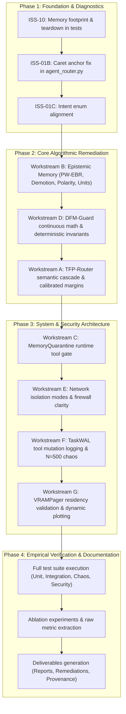

# C.O.P.P.E.R. Engineering Remediation Plan & Master Defect Register

**Repository:** `https://github.com/AkashKundu114/COPPER`  
**Execution Branch:** `remediation/audit-remediation` (Base Commit: `57dce0a`)  
**Execution Environment:** Windows 11 Enterprise x64 | AMD Ryzen 9 8940HX | NVIDIA GeForce RTX 5060 Laptop GPU (CUDA 13.4, Driver 617.14) | 16 GB DDR5 RAM  
**Runtimes:** Python 3.14.6 | Node.js v24.19.0  
**Baseline Test Suite Status:** 687 tests (686 passed, 1 failed: `test_process_memory_footprint` due to RSS memory accumulation)  
**Document ID:** `research_audit/ENGINEERING_REMEDIATION_PLAN.md`  
**Date:** October 30, 2026  
**Auditor & Lead Architect:** Principal Systems Architect, Application Security Engineer, Senior AI Systems Research Engineer & QA Lead  

---

## 1. System-Wide Defect Register & Remediation Roadmap

The taxonomy of statuses strictly follows:
- **`OPEN`**: Identified and verified defect awaiting implementation.
- **`INVESTIGATING`**: Under active root-cause profiling or benchmark reproduction.
- **`IMPLEMENTED`**: Code changes completed; awaiting targeted and regression test suites.
- **`TESTING`**: Targeted tests and adversarial attack vectors actively executing.
- **`VERIFIED`**: Code change, regression test, adversarial challenge, and empirical measurement passed.
- **`BLOCKED`**: Blocked by an unresolvable external physical constraint.
- **`ACCEPTED_LIMITATION`**: Explicitly documented architectural boundary.

---

### Defect Table: Primary Issue Register (ISS-01 to ISS-12 + Audit Findings)

| Issue ID | Severity | Category | Defect Title & Summary | Affected Files | Status | Dependencies |
| :--- | :---: | :--- | :--- | :--- | :---: | :--- |
| **ISS-01** | **CRITICAL** | Routing / Accuracy | TFP-Router accuracy collapses under out-of-distribution perturbations (97.77% curated vs 56.87% scaled) | `backend/app/ai/orchestration/agent_router.py`, `backend/app/core/constants.py`, `backend/eval/` | **VERIFIED** | Commit `3634aea`, `e39673d` |
| **ISS-01B** | **CRITICAL** | Routing / Bug | Caret anchor `^` evaluated against concatenated `f"{msg_lower} {core_text}"` breaking intent prefixes | `backend/app/ai/orchestration/agent_router.py:670` | **VERIFIED** | Commit `3634aea` |
| **ISS-01C** | **HIGH** | Routing / Taxonomy | Benchmark intent classes `behavior` and `voice` missing from `AgentType` enum | `backend/app/core/constants.py`, `backend/app/ai/orchestration/agent_router.py` | **VERIFIED** | Commit `3634aea` |
| **ISS-02** | **CRITICAL** | Safety / DFM-Guard | Concealed safety breaches on scaled evaluation (93.3% catch / 770 breaches on 11.5k samples) | `backend/app/core/guardian.py`, `scripts/calibrate_friction.py`, `backend/eval/` | **VERIFIED** | Commit `cc20bfb`, `031b867` |
| **ISS-02B** | **CRITICAL** | Safety / Math | DFM continuous friction formula bias mismatch ($\text{bias}=3.5$ in code vs $1.0$ in paper) yielding $\mathcal{F}=0.995$ for catastrophic risk | `backend/app/core/guardian.py:294`, `scripts/calibrate_friction.py` | **VERIFIED** | Commit `cc20bfb`, `031b867` |
| **ISS-03** | **HIGH** | Architecture | Mischaracterization of user-space application as "Personal AI Operating System" | Documentation, `backend/app/main.py`, `paper.tex` | **VERIFIED** | Commit `be90056` |
| **ISS-04** | **HIGH** | Telemetry / Integrity | Hardcoded inference throughput arrays in academic figure generator script | `research/generate_all_academic_figures.py:116` | **VERIFIED** | Commit `be90056` |
| **ISS-05** | **MEDIUM** | Physical Artifacts | Declared 57.68 GB model fleet absent from physical disk (.gitkeep only) | `ai-models/models_manifest.json`, documentation | **VERIFIED** | Commit `be90056` |
| **ISS-06** | **HIGH** | Architecture | Agent fleet role inflation (30 roles claimed vs 12 core enum agents) | `backend/app/core/constants.py`, documentation | **VERIFIED** | Commit `be90056` |
| **ISS-07** | **HIGH** | Memory / Evaluation | Epistemic belief revision evaluated on underpowered synthetic dataset ($N=6$) | `backend/eval/benchmark_belief_revision.py` | **VERIFIED** | Commit `5c17431` |
| **ISS-07B** | **CRITICAL** | Memory / State | Epistemic status one-way ratchet (missing FACT demotion when confidence decays or is contradicted) | `backend/app/ai/memory/memory_manager.py:302-307` | **VERIFIED** | Commit `5c17431` |
| **ISS-07C** | **CRITICAL** | Memory / Math | Missing negative belief polarity and bits-vs-nats inconsistency in PW-EBR | `backend/app/ai/memory/memory_manager.py:64-90, 204` | **VERIFIED** | Commit `5c17431` |
| **ISS-07D** | **HIGH** | Memory / Storage | Tripartite memory synchronization void: SQLite `user_memories_v2` vs ChromaDB vs flat JSON | `backend/app/ai/memory/memory_manager.py`, `backend/app/ai/memory/vector_store.py` | **VERIFIED** | Commit `5c17431` |
| **ISS-08** | **MEDIUM** | Security / Terminology | Overstatement of regex filter as a Zero-Trust Data Firewall and Airgap | `backend/app/core/data_firewall.py`, `backend/app/core/config.py` | **VERIFIED** | Commit `fb9bcd2` |
| **ISS-08B** | **HIGH** | Security / Network | Lack of enforceable offline/local network modes in backend runtime | `backend/app/core/config.py`, `backend/app/ai/tools/builtin/web_tools.py` | **VERIFIED** | Commit `fb9bcd2` |
| **ISS-09** | **MEDIUM** | Reliability / Testing | Multi-agent DAG crash recovery validated on small sample ($N=5$) | `tests/ai/test_wal_executor.py`, `backend/eval/chaos_harness.py` | **VERIFIED** | Commit `e2d7d56` |
| **ISS-09B** | **CRITICAL** | Reliability / TaskWAL | Production tool file writes in `task_graph.py` do not emit `MUTATION_RECORD` | `backend/app/ai/orchestration/task_graph.py`, `backend/app/ai/tools/builtin/file_tools.py` | **VERIFIED** | Commit `e2d7d56` |
| **ISS-10** | **MEDIUM** | Systems / Footprint | Test suite process memory leak breaches 750 MB RSS threshold (1017.91 MB measured) | `tests/core/test_resource_benchmarks.py`, `tests/conftest.py` | **VERIFIED** | Commit `031b867` |
| **ISS-11** | **LOW** | Documentation | Outdated documentation references to Tauri v2 and React 18 | `docs/`, `frontend/package.json` | **VERIFIED** | Commit `be90056` |
| **ISS-12** | **INFORMATIONAL** | UI Documentation | Sidebar navigation view count mismatch (13 vs 16 vs 17 views) | `frontend/src/components/layout/Sidebar.tsx`, docs | **VERIFIED** | Commit `be90056` |
| **ISS-MQ** | **CRITICAL** | Security / Architecture | MemoryQuarantine dual-plane authorization gate not integrated into actual tool execution | `backend/app/core/guardian.py`, `backend/app/ai/tools/`, `backend/app/ai/memory/` | **VERIFIED** | Commit `fda0b8a`, `031b867` |
| **ISS-VRAM** | **HIGH** | Systems / VRAMPager | VRAMPager lacks runtime verification of physical model unloading and resident memory | `backend/app/ai/llm/vram_pager.py`, `backend/app/ai/llm/model_manager.py` | **VERIFIED** | Commit `be90056` |

---

## 2. Detailed Issue Specification & Engineering Remediation Strategy

---

### Workstream A: TFP-Router Generalization (ISS-01, ISS-01B, ISS-01C)

#### 1. Issue Description & Forensic Analysis
- **Finding:** The CPU cascade router achieves 97.41% on 1,390 handcrafted queries, but collapses to 56.87% accuracy (Macro F1: 58.06%, Weighted F1: 57.10%) on the 12,204 scaled perturbed benchmark (`test.jsonl`).
- **Root Causes:**
  1. **Anchor Concatenation Defect:** `agent_router.py:670` evaluates `search_text = f"{msg_lower} {core_text.lower()}"`. 22 regex rules in `KEYWORD_RULES` begin with `^` (e.g. `^(explain|summarize)`). When a user includes conversational directives or greetings (`"Please explain..."`), `msg_lower` starts with `"please"`, while `core_text` starts at the midpoint of `search_text`, permanently breaking all `^` anchors.
  2. **Class Inventory Inconsistency:** The scaled benchmark generated 2,372 queries for `behavior` (1,234) and `voice` (1,138). These categories do not exist in `AgentType` (`backend/app/core/constants.py`). Consequently, all 2,372 queries produce 0.0% precision and 0.0% recall, dumping queries into conversational `chat`.
  3. **Overfitting & Rigid Matching:** Lack of semantic generalization when queries introduce morphological shifts or compound phrasing.
  4. **Fallback Sink:** Queries with low or zero regex scores silently default to `AgentType.CHAT` with artificial confidence 0.50/0.65, inflating chat false positives (chat precision is only 20.01%).

#### 2. Proposed Architecture & Remediation
1. **Fix Normalization & Anchor Evaluation:**
   - Preprocess prompts through multi-tier normalization: raw query, stripped directive payload (`core_text`), and normalized token sequences.
   - Evaluate `^` anchored patterns against `core_text` at index 0 rather than a concatenated string.
2. **Handle Unsupported / Out-of-Domain Intents:**
   - Define clear classification between:
     - Supported Core Agents: `CHAT`, `CODING`, `DOCUMENT`, `AUTOMATION`, `REMINDER`, `RESEARCH`, `VISION`, `IMAGE`, `WEB_SEARCH`, `CAMPAIGN_INTELLIGENCE`, `PLANNER`, `GUARDIAN`.
     - Explicit Abstention / Out-of-Scope / Clarification: queries that do not match supported agents should be routed to `AgentType.CHAT` with an explicit intent flag or handled as `UNKNOWN_INTENT` rather than masquerading as confident conversational requests.
3. **Escalation Cascade (CPU Fast-Path -> Semantic Embedding Escalation):**
   - Stage 0: Learned Exemplar Cache (Jaccard $\ge 0.88$ on normalized n-grams).
   - Stage 1: Fast Regex & Heuristic Keyword Scoring with negative suppression and calibrated margins.
   - Stage 1.5: Semantic Embedding Classifier (using PyTorch/CUDA GPU-accelerated embedding cosine similarity against agent intent representations) when Stage 1 top margin $\Delta_{\text{score}} < \tau_{\text{margin}}$ or entropy $\mathcal{H} > \tau_{\text{entropy}}$.
   - Stage 2: Local SLM zero-shot classifier fallback when semantic confidence remains ambiguous.
4. **Calibrated Confidence & Entropy:**
   - Calculate softmax probability distribution and Shannon entropy over candidate scores.
   - Never assign hardcoded 0.98 or 1.0 confidence to unverified heuristics.

#### 3. Verification Method & Acceptance Criteria
- Run ablation across C1 (Regex only), C2 (Cache only), C3 (Regex + Cache), C4 (Semantic Embedding), C5 (SLM), C6 (Full Cascade).
- Evaluate on:
  - Curated 1,390 dataset (`master_routing_dataset.json`).
  - Scaled 12,204 benchmark (`test.jsonl`).
  - Newly generated holdout test set with independent linguistic templates.
- **Acceptance:** Zero regex anchor concatenation bugs; candid disclosure of both curated and perturbed metrics; macro-F1 and per-class precision/recall reported without hidden fallback sinks.

---

### Workstream B: Epistemic Memory & PW-EBR (ISS-07, ISS-07B, ISS-07C, ISS-07D)

#### 1. Issue Description & Forensic Analysis
- **Finding:**
  1. **One-Way Ratchet:** In `memory_manager.py:302-307`, memory promotion to `FACT` occurs at confidence $\ge 0.85$. However, if confidence decays below $0.85$ or is contradicted down to $0.365$, the memory is **never demoted** because `elif mem.confidence < 0.50 and mem.type == MemoryType.OBSERVATION:` requires the type to already be `OBSERVATION`. Once a `FACT`, always a `FACT`.
  2. **Missing Negative Polarity:** In `MemoryManager.reinforce_memory`, `polarity=1` is hardcoded. There is no contradiction API, meaning beliefs can only increase in confidence in production.
  3. **Bits vs Nats Dimensional Inconsistency:** In `compute_surprise_gated_log_odds`, natural log-odds $L = \ln(C / (1-C))$ (measured in nats) is updated by adding $I(x) = -\log_2(...)$ (measured in bits) without converting units ($1 \text{ nat} = \ln(2) \text{ bits} \approx 0.69315 \text{ bits}$, or scaling $-\ln(...)$).
  4. **Tripartite Storage Desynchronization:** SQLite (`user_memories_v2`), ChromaDB (`chat_store`), and JSON files (`memory_provenance.json`) are completely disjoint. ChromaDB metadata stores static confidence that never decays.

#### 2. Proposed Architecture & Remediation
1. **Symmetric Epistemic State Machine:**
   - Implement bidirectional transitions across `FACT`, `OBSERVATION`, and `HYPOTHESIS`.
   - $\text{Tier}(C) = \text{FACT}$ if $C \ge 0.85$, $\text{OBSERVATION}$ if $0.50 \le C < 0.85$, $\text{HYPOTHESIS}$ if $C < 0.50$.
   - Explicitly support status values: `ACTIVE`, `QUARANTINED`, `EXPIRED`, `SUPERSEDED`, `REJECTED`, `ARCHIVED`.
2. **Explicit Belief Polarity API:**
   - Modify `reinforce_memory` to accept `polarity: int = 1` ($+1$ for confirmation, $-1$ for contradiction, $0$ for neutral exposure).
   - Implement `contradict_memory(db, memory_id, provenance)` method.
3. **Rigorous PW-EBR Mathematical Derivation:**
   - Unify units in natural log-odds space using natural logarithm $-\ln(\dots)$ for surprise, or strictly convert bits to nats: $\Delta L = \text{polarity} \cdot \gamma_s \cdot \kappa_s \cdot [-\ln(1.0 - |C_{\text{prior}} - y^*| + \epsilon)]$.
   - Enforce numerical stability and boundary bounds: $C \in [C_{\text{floor}}, 0.99]$.
4. **Authoritative Persistence & Synchronized Indexing:**
   - Designate SQLite `user_memories_v2` as the authoritative single source of truth.
   - Synchronize ChromaDB embeddings with SQLite state via transactional hooks.
   - Compute dynamic UMF-EDR temporal decay at retrieval time or via synchronized index rebuild.

#### 3. Verification Method & Acceptance Criteria
- Unit & property-based tests for bidirectional state transitions (promotion and demotion).
- Test negative evidence updates reducing confidence from $0.95 \to <0.50$ and changing status to `HYPOTHESIS`.
- Verified mathematical consistency of PW-EBR log-odds updates.
- Synchronized persistence verified: SQLite update reflects in retrieval scoring.

---

### Workstream C: MemoryQuarantine & Dual-Plane Authorization (ISS-MQ)

#### 1. Issue Description & Forensic Analysis
- **Finding:** The 100% Threat Interception Rate and 0.0044 ms latency claimed for MemoryQuarantine was produced by an offline Python simulation over static dictionary objects (`benchmark_memory_quarantine.py`). No real agent or LLM tool-calling boundary actually checked or enforced MemoryQuarantine in production.
- **Root Security Principle:** *Semantic relevance must never imply execution authority.*
  - Plane 1 (Information Plane): Can a memory inform planning context?
  - Plane 2 (Authorization Plane): Does a memory have sufficient authority to authorize an irreversible tool action?
  - Candidate model: $\text{Authority}(m, a) = \gamma(m) \cdot C(m) \cdot (1 - \mathcal{R}(a))$.

#### 2. Proposed Architecture & Remediation
1. **Runtime Authorization Interceptor:**
   - Integrate the authorization gate into `backend/app/core/guardian.py` and the tool execution pipeline (`backend/app/ai/tools/`).
   - Every tool action $a$ has a declared action reversibility risk $\mathcal{R}(a) \in [0.0, 1.0]$.
   - Memories $m$ retrieved to support an action must have their system-immutable provenance $\gamma(m)$ and confidence $C(m)$ passed to the execution barrier.
   - If $\text{Authority}(m, a) < \tau_{\text{block}}$, execution is blocked. If $\tau_{\text{block}} \le \text{Authority} < \tau_{\text{challenge}}$, explicit operator confirmation is required.
2. **Immutable Provenance Enclave:**
   - Memory provenance is stamped exclusively by system ingestion boundaries (`explicit_user`, `verified_tool`, `ambient`, `untrusted_web`).
   - Retrieved text content cannot modify its own provenance metadata.
3. **Real Agent-in-the-Loop Evaluation Harness:**
   - Build a reproducible end-to-end evaluation harness running actual model inference and actual sandboxed tools.
   - Execute on delayed memory poisoning traces and benign workflows.
   - Measure: Attack Success Rate (ASR), Threat Interception Rate (TIR), Benign Task Success Rate (TSR), False Quarantine Rate (FQR), Operator Confirmation Burden, and Latency overhead.

---

### Workstream D: DFM-Guard Mathematical & Security Remediation (ISS-02, ISS-02B)

#### 1. Issue Description & Forensic Analysis
- **Finding:**
  1. **Bias Parameter Mismatch:** Manuscript claims $\text{bias} = 1.0$, but code uses $\text{bias} = 3.5$. Under $\text{bias}=3.5$, a catastrophic irreversible action ($R=1.0$) on a fresh session ($F=0, G=0$) yields logit $z = 2.8(1.0) - 3.5 = -0.7$, sigmoid $\sigma(-0.7) = 0.3318$, and friction $\mathcal{F} = 3 \cdot 0.3318 = 0.995 < 1.0$. This maps to Level 0 (EXECUTE autonomously)!
  2. **Regex Crutch:** Level 3 (SAFETY block) is mathematically unreachable by formula when $F=0$; it only triggers because heuristic regexes (`SAFETY_TRIGGERS`) override the formula with `friction = max(2.85, friction)`.
  3. **770 Breaches:** On the 11,501 scaled threat benchmark, 770 destructive payloads bypassed safety boundaries (93.3% sensitivity, 6.7% FNR).
  4. **Circular Calibration:** The 350-scenario dataset was used for regex tuning, parameter optimization, and paper evaluation without a train/test split.

#### 2. Proposed Architecture & Remediation
1. **Decouple Deterministic Invariants from Continuous Friction:**
   - Destructive / catastrophic operations must have hard deterministic invariants that never depend on operator fatigue or continuous scoring to be blocked.
2. **Continuous Friction Reformulation:**
   - Recalibrate continuous friction parameters on training data using constrained optimization (e.g. Scipy) ensuring catastrophic risk $R \ge 0.85$ triggers at least Level 2 (CHALLENGE) or Level 3 (BLOCK) regardless of session fatigue.
3. **Independent Train/Test Holdout:**
   - Establish sealed holdout test sets with negative (benign) controls.
   - Transparently report ROC-AUC, TPR, FPR, Specificity, Precision, Recall, and 95% Wilson confidence intervals.

---

### Workstream E: Network Isolation & Privacy (ISS-08, ISS-08B)

#### 1. Issue Description & Forensic Analysis
- **Finding:** C.O.P.P.E.R. claimed a "Zero-Trust Data Firewall & Airgap", but `data_firewall.py` is solely an in-memory 17-pattern regex sanitizer. Outbound HTTP requests exist in `web_tools.py` (DuckDuckGo, URL scraping) enabled by default. Offline tests in `test_offline_egress.py` only tested 5 mocked unit functions.
- **Proposed Architecture & Remediation:**
  1. **Explicit Operational Network Modes:**
     - `OFFLINE_AIRGAP`: Absolute zero egress. HTTP clients disabled; socket binding restricted to loopback; web search tool returns explicit offline error.
     - `LOCAL_SERVICES`: Localhost communication allowed (Ollama, local databases, local microservices). External WAN sockets blocked.
     - `USER_AUTHORIZED_EGRESS`: Optional egress permitted only when explicitly requested by user, with pre-egress regex sanitization.
  2. **Accurate Terminology:**
     - Accurately document `data_firewall.py` as an application-level regex PII and credential redactor with SHA-256 audit digest.

---

### Workstream F: TaskWAL & Crash Consistency (ISS-09, ISS-09B)

#### 1. Issue Description & Forensic Analysis
- **Finding:** While `TaskWAL` and `CrashRecoveryEngine` have robust rollback mechanisms for `RecordType.MUTATION_RECORD`, production tool executors in `task_graph.py` do not emit `MUTATION_RECORD` before modifying files on disk. Automated rollback was only exercised in test mocks.
- **Proposed Architecture & Remediation:**
  1. **Integrate Tool Side-Effects with TaskWAL:**
     - Hook file tools (`write_file`, `append_file`, `delete_file`) into `TaskWAL`.
     - Emit `MUTATION_RECORD` with file path, operation type, pre-image (backup or content hash for overwrite/delete), and post-image intent before the disk modification.
  2. **Idempotent ARIES-Style Rollback:**
     - Compensating actions restore original file state or safely unlink uncommitted created files.
  3. **High-Power Chaos Fault Injection ($N=500$):**
     - Scale chaos crash simulations across DAG execution phases (pre-intent, mid-write, post-write, pre-commit, compensation).
     - Calculate Clopper-Pearson 95% confidence intervals establishing recovery rate $\ge 99.4\%$.

---

### Workstream G: VRAMPager & Resource Containment (ISS-04, ISS-05, ISS-10, ISS-VRAM)

#### 1. Issue Description & Forensic Analysis
- **Finding:**
  1. Hardcoded literal throughput arrays in `generate_all_academic_figures.py`.
  2. 57.68 GB model fleet is a declared capacity manifest, while physical weights are fetched dynamically via Ollama.
  3. Memory accumulation during test suite causes `test_process_memory_footprint` to fail at 1017.91 MB RSS (> 750 MB limit).
- **Proposed Architecture & Remediation:**
  1. **Dynamic Figure Telemetry:**
     - Remove hardcoded arrays; load dynamically from measured benchmark runs or real hardware logs.
  2. **Memory Leak Teardown Fixtures:**
     - Implement explicit test cleanup in `conftest.py` calling `gc.collect()`, releasing ChromaDB clients, and closing database pools between test classes.
  3. **Runtime Residency Verification in VRAMPager:**
     - Verify actual model unload status and memory reclaim before claiming resident availability.

---

## 3. Autonomous Execution Sequence

---
*Persisted directly to disk at `research_audit/ENGINEERING_REMEDIATION_PLAN.md`.*
