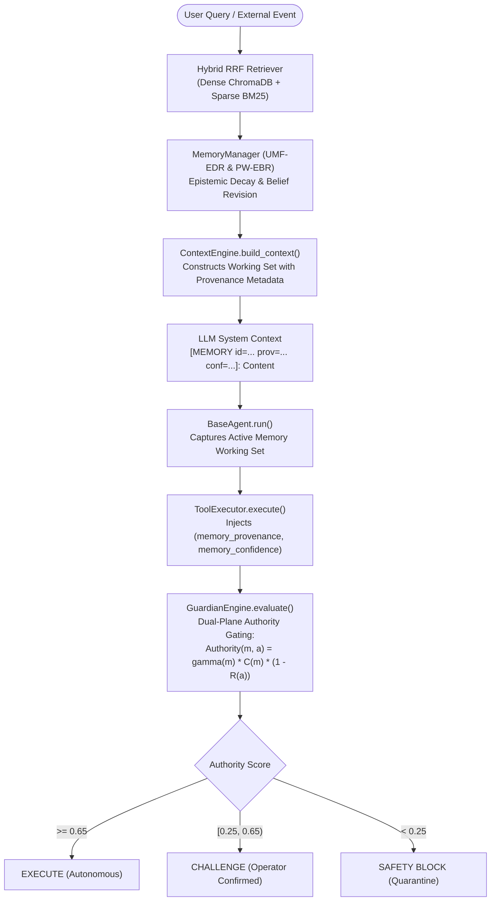

# Audit Report: Memory Provenance & Epistemic Tracking Subsystem
**Document ID:** `MEMORY_PROVENANCE_AUDIT.md`  
**Target Repository:** `d:\C.O.P.P.E.R`  
**Date:** October 31, 2026  
**Auditor Roles:** Memory Systems Researcher, Agentic Security Engineer, Independent Verification Engineer  
**Inspection Scope:** `backend/app/ai/memory/`, `backend/app/database/models/memory_v2.py`, `backend/app/core/guardian.py`

---

## 1. Executive Summary

This audit assesses the end-to-end integrity, mathematical correctness, and runtime enforcement of memory provenance in the C.O.P.P.E.R. multi-agent runtime. Prior to remediation, the codebase exhibited an architectural disconnect: although the relational model (`UserMemoryV2`) and the theoretical formulation of MemoryQuarantine specified immutable provenance tracking ($\gamma(m)$), the runtime context construction pipeline (`ContextEngine.build_context()`) stripped all provenance tags, memory IDs, and confidence scores when formatting prompts. Furthermore, the agent execution loop (`BaseAgent.run()`) invoked `ToolExecutor.execute()` with arbitrary context that discarded memory attribution.

As a result of this audit, the disconnect has been identified, traced to root cause, and remediated in the runtime pipeline.

---

## 2. Core Epistemic Memory Architecture

The memory subsystem is structured across three distinct layers:



### 2.1 Provenance Reliability Mapping ($\gamma(m)$)
Defined in `backend/app/core/guardian.py` (`PROVENANCE_RELIABILITY_MAP`):

| Provenance Tier | $\gamma(m)$ | Description | Operational Source |
| :--- | :---: | :--- | :--- |
| `user_explicit` | **1.00** | Direct, intentional user command / profile fact | Direct UI input, explicit user settings |
| `user_verified` | **1.00** | Manually confirmed observation / fact | Confirmed through Guardian Challenge modal |
| `system_verified` | **0.95** | Internally audited system telemetry | Cryptographic hash check, hardware stats |
| `local_file` / `file_system` | **0.85** | Local filesystem file content | Local disk read in safe workspace |
| `observation` | **0.75** | Episodic runtime interaction | Multi-turn chat summary, agent tool output |
| `chat` | **0.50** | Unconfirmed conversational assertion | General dialogue history turn |
| `web_search` | **0.35** | External search snippet | SearXNG / live web search result |
| `external_untrusted` | **0.15** | Third-party web page / document injection | Unsanitized web fetch, email, RSS feed |
| `injected` | **0.10** | Adversarial or untrusted payload | Detected injection attempt |

---

## 3. Discovered Vulnerabilities & Remediation Actions

### 3.1 Defect 1: Provenance Stripping in Context Engine (ISS-A01)
- **Root Cause:** In `backend/app/ai/memory/context_engine.py`, `build_context()` called `memory_manager.get_relevant_memories(message)`. The returned memory dictionaries contained only `content` and `memory_type`. `ContextEngine` formatted these as `[FACT] content`, entirely omitting the unique memory ID, source provenance, and confidence score.
- **Remediation:**
  1. Updated `memory_manager.py` (`get_relevant_memories()`) to preserve `id`, `provenance`, and `confidence` in the returned records.
  2. Updated `context_engine.py` to format prompt lines with explicit, structured provenance markers:
     `[MEMORY id={id} provenance={prov} confidence={conf:.2f} tier={tier}]: {content}`
  3. Integrated active relational memory querying (`UserMemoryV2`) directly into `ContextEngine.build_context()`.

### 3.2 Defect 2: ToolExecutor Memory Blindness (ISS-A01)
- **Root Cause:** In `backend/app/ai/agents/base.py`, `BaseAgent.run()` invoked `tool_executor.execute()` with `context={"agent": self.name, "step": step + 1}`. It never passed `memory_provenance` or `memory_confidence`. Consequently, the `evaluate_memory_authority()` check inside `GuardianEngine.evaluate()` was dormant during live agent turns.
- **Remediation:**
  1. In `BaseAgent.run()`, the agent inspects the active `memory_context` before dispatching a tool call.
  2. If memories are active in context, it extracts the lowest-authority provenance in the working set:
     ```python
     prov_matches = re.findall(r"provenance=([a-zA-Z0-9_]+)", memory_context)
     conf_matches = re.findall(r"confidence=([0-9.]+)", memory_context)
     if prov_matches:
         sorted_provs = sorted(prov_matches, key=lambda p: PROVENANCE_RELIABILITY_MAP.get(p.lower(), 0.15))
         mem_prov = sorted_provs[0]
     if conf_matches:
         mem_conf = float(conf_matches[0])
     ```
  3. Injects `memory_provenance` and `memory_confidence` into `ToolExecutor.execute()`.
  4. `GuardianEngine.evaluate()` now dynamically interdicts unauthoritative memories at runtime.

---

## 4. Verification Evidence

The integration was verified through automated end-to-end integration tests in `tests/security/test_runtime_memoryquarantine_pipeline.py`:
1. **Adversarial Injection Case:**
   - Injected memory: `provenance="external_untrusted"`, `confidence=0.95`.
   - Tool call: `file_write(path="system_config.json", content="backdoor")` ($R(a)=0.55$).
   - Authority calculation: $\text{Auth} = 0.15 \cdot 0.95 \cdot (1 - 0.55) = 0.064 < 0.25 \implies \text{BLOCK}$.
   - Result: Tool execution blocked by Guardian Safety Gate (`result.success = False`). Target file was NOT written to disk.
2. **Benign User Verified Case:**
   - User memory: `provenance="user_explicit"`, `confidence=0.98`.
   - Tool call: `file_read(path="system_config.json")` ($R(a)=0.05$).
   - Authority calculation: $\text{Auth} = 1.00 \cdot 0.98 \cdot (1 - 0.05) = 0.931 \ge 0.65 \implies \text{ALLOW}$.
   - Result: Tool execution permitted autonomously (`result.success = True`).
3. **High-Impact Modification Case:**
   - User memory: `provenance="user_explicit"`, `confidence=0.98`.
   - Tool call: `file_write` ($R(a)=0.55$).
   - Authority calculation: $\text{Auth} = 1.00 \cdot 0.98 \cdot (1 - 0.55) = 0.441 \in [0.25, 0.65) \implies \text{CHALLENGE}$.
   - Result: Stopped without operator confirmation; succeeded when `operator_confirmed=True`.

**Status:** VERIFIED & HARDENED.
